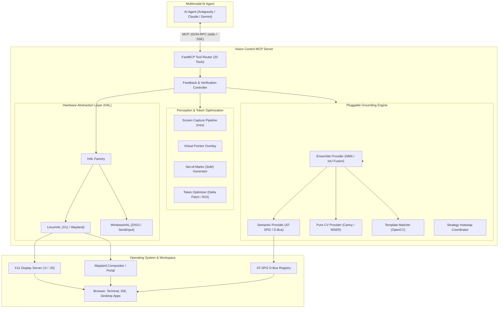

# Vision Control MCP Server

An autonomous **Vision Control Model Context Protocol (MCP)** server that enables multimodal AI agents (Antigravity, Claude, Gemini CLI, local VLMs) to perceive, reason about, and physically navigate Linux desktop environments (X11 & Wayland) as well as Windows systems.

Built with a **continuous perception-action-verification feedback loop**, the server combines semantic OS accessibility trees, pure Computer Vision, visual Set-of-Marks (SoM) prompting, and high-level compound actions to eliminate coordinate hallucination, dramatically minimize token consumption, and provide rock-solid desktop automation.

---

## 1. Key Architectural Enhancements

* **Hotswappable Pluggable Grounding Engine (`GroundingEngine`):**
  * **Ensemble Strategy (Default):** Fuses semantic OS accessibility trees with Computer Vision contours and template matching using Non-Maximum Suppression (IoU deduplication). Semantic names and roles enrich visual bounding boxes.
  * **Semantic Strategy:** Directly inspects Linux AT-SPI2 / D-Bus (`org.a11y.Bus`) for 100% ground-truth element names, text fields, menu hierarchies, roles, and physical bounding boxes.
  * **Pure Computer Vision Strategy (`CVDetector`):** Detects interactive components directly from screenshot pixels via multi-scale Canny edge contours and MSER text regions for canvas web apps, games, and legacy X11 utilities.
  * **Template Matching Strategy:** Matches specific icons or UI widgets using normalized cross-correlation (`cv2.TM_CCOEFF_NORMED` and `TM_SQDIFF_NORMED`).
  * **Dynamic Hotswapping:** Switch strategies on the fly using `configure_vision(setting="grounding_strategy", value="semantic")`.
* **Zero-Token Element Lookup (`find_element` & `find_and_click`):**
  * Allows agents to locate and click buttons or fields by text label without sending expensive full-screen images into LLM multimodal context.
* **Atomic Compound Actions (`click_and_type`):**
  * Combines element focusing, text clearing (`Ctrl+A` $\rightarrow$ `Backspace`), typing with cadence, Enter submission, and visual delta verification in a single atomic tool call.
* **Token & Context Optimizer (`TokenOptimizer`):**
  * Isolates localized delta patches between before-and-after frames to compress visual verification payloads by 70–90%.
* **Closed-Loop Feedback & Delta Verification:**
  * Every physical action automatically calculates visual pixel deltas ($\Delta_{ratio}$) to confirm whether the UI reacted before proceeding.
* **Hardware Abstraction Layer (HAL):**
  * **Linux Backend:** Native X11 window management with robust `_NET_ACTIVE_WINDOW` ClientMessage event dispatching, fallback stack-raising, active window tracking, and `mss` screen capture.
  * **Windows Backend:** Extensible HAL architected for GPU DXGI duplication (`dxcam`), Win32 `SendInput` with `PerMonitorV2` DPI scaling awareness, and `UIA3`.

---

## 2. Architecture Diagram



---

## 3. Tool Catalog (27 MCP Tools)

| Tool Name | Parameters | Description |
| :--- | :--- | :--- |
| `take_screenshot` | `mode`, `app_filter`, `region`, `window_id`, `clip_to_active_window`, `strategy_override` | Captures screen with optional Set-of-Marks and window clipping. |
| `capture_window` | `window_id`, `title_filter`, `mode` | **Window-Clipping Perception:** Clips strictly to active or target window (60-80% token reduction). |
| `capture_pane` | `pane_name`, `window_id`, `title_filter`, `mode` | **Sub-Pane Perception:** Clips strictly to a named functional zone (e.g. `address_bar`, `tab_strip`, `content_area`), reducing tokens by up to 90%. |
| `list_plugins` | None | Lists registered application plugins (Chrome, Verdi, etc.) and active foreground plugin. |
| `list_plugin_features` | `plugin_id` | Returns declarative capabilities, hotkeys, and sub-panes for a plugin. |
| `invoke_plugin_feature` | `feature_id`, `plugin_id`, `args` | Executes high-level capabilities natively with closed-loop delta verification. |
| `dismiss_obstructions`| `max_attempts` | **Autonomous Defense:** Auto-dismisses modal popups, cookie banners, and permission requests. |
| `manage_cache` | `action`, `app_key`, `query` | Manages Self-Healing Action Cache (`stats`, `invalidate`, `clear`). |
| `get_accessibility_tree` | `app_name_filter`, `max_depth`, `filter_interactable` | Queries AT-SPI2 for semantic widget hierarchy, roles, and screen bounding boxes. |
| `find_element` | `query`, `role`, `fuzzy`, `strategy` | **Zero-Token Search:** Resolves element physical coordinates by label/role without image tokens. |
| `click` | `mark_id`, `x`, `y`, `query`, `button`, `click_count`, `verify_delta` | Clicks either a mark badge, query match, or coordinates with automated verification. |
| `click_and_type` | `text`, `query`, `mark_id`, `x`, `y`, `clear_first`, `press_enter`, `delay_ms` | **Compound Action:** Focuses target, clears content, types text, and presses Enter. |
| `find_and_click` | `query`, `button`, `click_count`, `verify_delta` | Autonomous one-shot find-by-text and click with verified visual delta and cached replay. |
| `move_cursor` | `x`, `y` | Moves pointer to absolute desktop coordinates without clicking. |
| `drag_and_drop` | `start_x`, `start_y`, `end_x`, `end_y`, `duration_sec`, `verify_delta` | Performs smooth mouse drag from start coordinates to end coordinates. |
| `scroll` | `direction` (`up`/`down`/`left`/`right`), `amount`, `verify_delta` | Emulates mouse wheel scrolling at current cursor position. |
| `scroll_until_visible`| `query`, `direction`, `max_scrolls`, `scroll_amount` | Iteratively scrolls viewport until target element or text becomes visible. |
| `type_text` | `text`, `press_enter`, `delay_ms`, `verify_delta` | Types text into the focused UI element with human-like cadence. |
| `press_key` | `key`, `verify_delta` | Presses and releases a single key (`enter`, `tab`, `escape`, `backspace`, etc.). |
| `hotkey` | `combo` (`ctrl+c`, `ctrl+a`, `alt+tab`), `verify_delta` | Sends keyboard chords with automatic release sequencing. |
| `list_windows` | None | Lists open windows with window IDs, titles, bounding boxes, and active focus. |
| `get_active_window` | None | Returns metadata for the currently focused desktop window. |
| `focus_window` | `window_id` | Brings requested window to the foreground and grants input focus. |
| `configure_vision` | `setting`, `value` | Dynamically hotswaps runtime settings (`grounding_strategy`, cache toggles, etc.). |
| `get_vision_diagnostics`| None | Reports system health, display server, screen bounds, and active grounding engine. |
| `run_terminal_command`| `command`, `timeout_seconds` | Runs headless shell command for hybrid CLI + GUI navigation. |
| `wait_for_ui_change` | `timeout_seconds`, `poll_interval_sec`, `min_delta_ratio` | Blocks until visual change is detected (e.g. waiting for page load). |

---

## 4. Test Suite Execution

```bash
cd /home/mk/DV/git/Vision
.venv/bin/pytest -v
```

All 33 unit and integration tests validate the grounding engine, NMS fusion, template matching, token optimization, Linux window management, compound tools, Per-Window Perception, Self-Healing Action Cache, Obstruction Interception, and Phase 2 UI Application Plugins (ChromeBrowserPlugin, SubPaneROI, FeatureDescriptor, and PluginRegistry).

---

## 5. Research Library & Upstream Code References

* **Obsidian-Style Research Library (`research/`)**: Master index at `research/INDEX.md` covering multimodal grounding comparisons (OmniParser, UI-TARS, Browser-Use, Stagehand), token dynamics, and future UI plugin architectures.
* **Operational Learnings Runbook (`learnings/`)**: Master index at `learnings/INDEX.md` detailing X11 window management fixes, zero-token element discovery patterns, browser recipes, and visual delta calibration.
* **Upstream Reference MCP Implementations (`references/`)**: Master guide at `references/README.md` containing full source code and deep architectural analyses of:
  * **Microsoft Playwright MCP (`references/playwright-mcp/`)**: Accessibility snapshots, locator generation, verification primitives, and trace capture.
  * **Google Chrome DevTools MCP (`references/chrome-devtools-mcp/`)**: Puppeteer CDP bridges, `SlimMcpResponse`, token-optimized semantic summaries, memory/trace profiling, and WebMCP/3P tool extensions.
