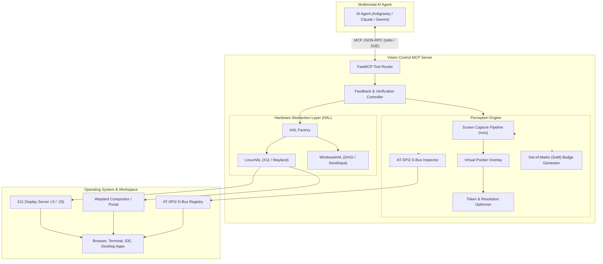

# Vision Control MCP Server

An autonomous **Vision Control Model Context Protocol (MCP)** server that enables multimodal AI agents (Antigravity, Claude, Gemini CLI, local VLMs) to perceive, reason about, and physically navigate Linux desktop environments (X11 & Wayland) as well as Windows systems.

Built with a **continuous perception-action-verification feedback loop**, the server combines semantic OS accessibility trees with visual Set-of-Marks (SoM) prompting to eliminate coordinate hallucination and provide rock-solid desktop automation across terminal, browser, and complex desktop applications.

---

## 1. Key Architectural Features

* **Dual Grounding Strategy (Semantic + Visual):**
  * **Semantic Grounding (AT-SPI2 / D-Bus):** Directly inspects the Linux accessibility bus (`org.a11y.Bus`) to retrieve exact button names, text fields, menu hierarchies, roles, and physical bounding boxes without relying purely on pixel guessing.
  * **Visual Grounding (Set-of-Marks / SoM):** Overlays high-contrast, numbered badges onto interactive UI elements. The LLM simply outputs `click(mark_id=4)` instead of predicting floating-point coordinates.
* **Closed-Loop Feedback & Delta Verification:**
  * Every physical action (click, type, hotkey, scroll) automatically captures pre- and post-action observation frames.
  * Measures visual pixel deltas to verify whether the screen reacted (e.g., verifying a dropdown opened or text was entered) before proceeding to the next step.
* **Hardware Abstraction Layer (HAL):**
  * **Linux Backend:** Auto-detects X11 vs Wayland. Employs `mss` for sub-80ms screen capture, `pynput` and `XTest` for input injection, and `python-xlib` for window hierarchy and focus control.
  * **Windows Backend:** Extensible HAL architecture architected for GPU DXGI duplication (`dxcam`), Win32 `SendInput` with `PerMonitorV2` DPI scaling awareness, and `UIA3`.
* **VLM Token & Latency Optimization:**
  * Raw 4K screenshots (3024x1898) consume megabytes and excessive multimodal tokens.
  * Dynamic aspect-ratio-preserving downscaling (configurable max dimension, default 1600px) and JPEG/WebP compression keep frame payloads under 250KB while preserving crisp text legibility.
* **Hybrid Vision + Terminal Workflow:**
  * Includes a sandboxed `run_terminal_command` tool for tasks where command-line execution is vastly faster than clicking menus (e.g. launching processes, checking disk space, inspecting logs).

---

## 2. Architecture Diagram



---

## 3. Tool Catalog (13 MCP Tools)

| Tool Name | Parameters | Description |
| :--- | :--- | :--- |
| `take_screenshot` | `mode` (`annotated_som`, `cursor_only`, `raw`), `app_filter`, `region` | Captures screen with optional Set-of-Marks badge overlays and virtual cursor. |
| `get_accessibility_tree` | `app_name_filter`, `max_depth`, `filter_interactable` | Queries AT-SPI2 for semantic widget hierarchy, roles, and screen bounding boxes. |
| `click` | `mark_id` (optional), `x`, `y`, `button`, `click_count`, `verify_delta` | Clicks either a numbered mark badge or specific (x, y) coordinates with verification. |
| `move_cursor` | `x`, `y` | Moves pointer to absolute desktop coordinates without clicking. |
| `drag_and_drop` | `start_x`, `start_y`, `end_x`, `end_y`, `duration_sec`, `verify_delta` | Performs smooth mouse drag from start coordinates to end coordinates. |
| `scroll` | `direction` (`up`, `down`, `left`, `right`), `amount`, `verify_delta` | Emulates mouse wheel scrolling at current cursor position. |
| `type_text` | `text`, `press_enter`, `delay_ms`, `verify_delta` | Types text into the focused UI element with human-like cadence. |
| `press_key` | `key` (`enter`, `tab`, `escape`, `backspace`, `space`, `f5`, etc.), `verify_delta` | Presses and releases a single key. |
| `hotkey` | `combo` (`ctrl+c`, `ctrl+alt+t`, `alt+tab`, etc.), `verify_delta` | Sends keyboard chords with automatic release sequencing. |
| `list_windows` | None | Lists open windows with window IDs, titles, bounding boxes, and active focus. |
| `focus_window` | `window_id` | Brings requested window to the foreground. |
| `run_terminal_command` | `command`, `timeout_seconds` | Runs headless shell command for hybrid CLI + GUI navigation. |
| `wait_for_ui_change` | `timeout_seconds`, `poll_interval_sec`, `min_delta_ratio` | Blocks until visual change is detected (e.g. waiting for page load). |

---

## 4. Installation & Quickstart

### Prerequisites
* Linux (Ubuntu 22.04+, Debian 12+, Fedora, Arch) with X11 or Wayland
* Python 3.10+
* System packages for AT-SPI2 and X11:
  ```bash
  sudo apt-get update && sudo apt-get install -y python3-gi gir1.2-atspi-2.0 at-spi2-core
  ```

### Virtual Environment Setup
```bash
cd /home/mk/DV/git/Vision
python3 -m venv --system-site-packages .venv
source .venv/bin/activate
pip install -e .
```

### Running the Test Suite
```bash
pytest -v
```

---

## 5. Integrating with AI Clients

### Antigravity / Claude Desktop / Claude Code Configuration
Add the server entry to your MCP configuration (`~/.gemini/antigravity-ide/mcp_config.json` or `claude_desktop_config.json`):

```json
{
  "mcpServers": {
    "vision-control": {
      "command": "/home/mk/DV/git/Vision/.venv/bin/python3",
      "args": ["-m", "vision_mcp.server"],
      "env": {
        "DISPLAY": ":0",
        "PYTHONUNBUFFERED": "1"
      }
    }
  }
}
```

---

## 6. Project Layout

```
Vision/
├── pyproject.toml              # Build backend and project metadata
├── requirements.txt            # Python dependencies
├── README.md                   # Documentation and usage guide
├── vision_mcp/
│   ├── __init__.py
│   ├── config.py               # Runtime settings (scaling, quality, safety failsafes)
│   ├── types.py                # Pydantic schemas (UIElement, BoundingBox, WindowInfo)
│   ├── hal/                    # Hardware Abstraction Layer
│   │   ├── base.py             # IDesktopHAL abstract interface
│   │   ├── factory.py          # Platform detector (Linux vs Windows)
│   │   ├── linux.py            # Linux HAL (mss, pynput, python-xlib)
│   │   └── windows.py          # Windows HAL (DXGI, SendInput, UIA3)
│   ├── perception/             # Vision & Semantic Grounding
│   │   ├── capture.py          # Screenshot pipeline, downscaling, cursor rendering
│   │   ├── som.py              # Set-of-Marks numbered badge generator
│   │   └── atspi.py            # AT-SPI2 D-Bus accessibility tree inspector
│   ├── agent_loop/             # Closed-Loop Feedback
│   │   └── controller.py       # Execution with pre/post visual delta verification
│   └── server.py               # FastMCP Server exposing 13 navigation tools
└── tests/
    ├── conftest.py             # Pytest fixtures and mock desktop HAL
    ├── test_hal.py             # Unit tests for HAL and failsafes
    ├── test_som.py             # Unit tests for Set-of-Marks and scaling
    ├── test_loop.py            # Unit tests for delta verification
    └── test_server.py          # Integration tests for tool execution
```

---

## 7. Safety & Guardrails

* **Failsafe Corner:** Moving the mouse cursor or forcing an action to `(0, 0)` triggers an immediate emergency abort (`RuntimeError`), stopping any automated drag or repeating loop.
* **Input Cooldown:** Configurable 50ms action cooldown (`CONFIG.action_cooldown_ms`) prevents event flooding and allows the display server event queue to settle.
* **Resolution Independence:** All clicks and Set-of-Marks coordinates automatically preserve physical screen space regardless of image downscaling factors.
