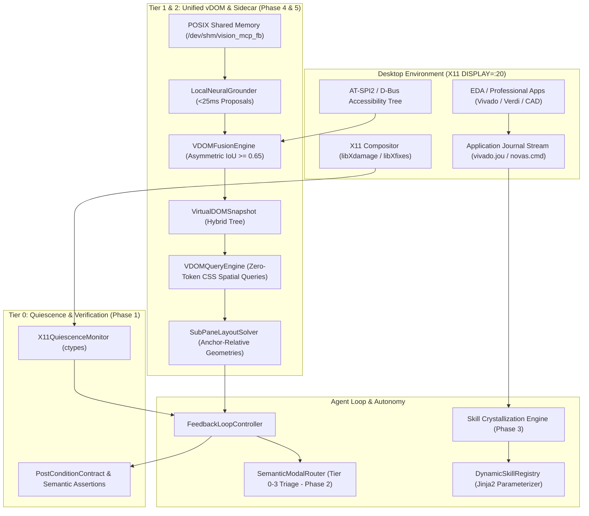

# Vision Control MCP 2.0 Implementation Runbook & Architectural Reference

## Executive Summary

Following a 3-round deep architectural critique and research dialogue with **Google Gemini 4 Argon**, the Vision Control MCP was upgraded from a reactive, pixel-diff-dependent vision agent into **Vision Control MCP 2.0**—a 5-phase deterministic, event-driven, zero-token desktop perception and automation system.

All 5 core architectural phases have been implemented, tested (62/62 unit tests passing, 100% pass rate), and committed to master.

---

## 1. 5-Phase Architecture Overview



---

## 2. Phase-by-Phase Deliverables

### Phase 1 (P0): Event-Driven Quiescence & Semantic Verification Engine
* **Source**: [`vision_mcp/hal/quiescence.py`](file:///home/mk/DV/git/Vision/vision_mcp/hal/quiescence.py)
* **Tests**: [`tests/test_quiescence.py`](file:///home/mk/DV/git/Vision/tests/test_quiescence.py)
* **Git Commit**: `dabb67d`
* **Capabilities**:
  * Loads `libX11.so.6`, `libXdamage.so.1`, and `libXfixes.so.3` via Python `ctypes`.
  * Monitors desktop dirty rects ($area \ge 64\text{ px}$) and mouse cursor busy state (`XFixesGetCursorImage`).
  * Implements 6-phase quiescence loop: `DISPATCHED` $\rightarrow$ `DAMAGE_ACCUMULATION` $\rightarrow$ `SETTLING` $\rightarrow$ `QUIESCENT` / `ASYNC_PROMOTED`.
  * Evaluates declarative `PostConditionContract` (e.g. `TEXT_APPEARED`, `WINDOW_SPAWNED`, `AT_SPI_STATE_PRESENT`, `CURSOR_CHANGED`) instead of relying solely on image pixel differences.

### Phase 2 (P3): Semantic Modal Triage & Policy Router
* **Source**: [`vision_mcp/agent_loop/obstruction.py`](file:///home/mk/DV/git/Vision/vision_mcp/agent_loop/obstruction.py)
* **Tests**: [`tests/test_modal_triage.py`](file:///home/mk/DV/git/Vision/tests/test_modal_triage.py)
* **Git Commit**: `aa6f96c`
* **Capabilities**:
  * 4-Tier safety classification:
    * **Tier 0 (BENIGN_DISMISSIBLE)**: "Tip of the Day", "Welcome" $\rightarrow$ Auto-dismiss with safe buttons.
    * **Tier 1 (INFORMATIVE_ACK)**: "Synthesis Completed", "DRC Finished" with single [OK] $\rightarrow$ Auto-acknowledge.
    * **Tier 2 (WORKFLOW_BRANCHING)**: "Synthesis Out-of-Date. Re-run?" $\rightarrow$ Halts, returns escalation payload with selectable buttons.
    * **Tier 3 (DESTRUCTIVE_OR_SYSTEM)**: "Overwrite timing.xdc?", "License failed" $\rightarrow$ Strict halt, requires explicit choice.
  * MCP tools: `dismiss_obstructions()` and zero-token `resolve_modal_dialog(button_id, button_label)`.

### Phase 3 (P2): GUI-to-Script Skill Crystallization Engine
* **Source**: [`vision_mcp/crystallization/`](file:///home/mk/DV/git/Vision/vision_mcp/crystallization/)
* **Tests**: [`tests/test_crystallization.py`](file:///home/mk/DV/git/Vision/tests/test_crystallization.py)
* **Git Commit**: `bd0835d`
* **Capabilities**:
  * `JournalCorrelator`: Tracks inotify/byte-offsets on EDA journal files (`vivado.jou`, `novas.cmd`), bracketing physical actions and stripping viewport noise.
  * `TclTrajectoryCompiler`: Deduplicates redundant selections (`select_objects`), lifts entity literals into Jinja2 `{{parameter}}` variables, and injects blocking sync barriers (`launch_runs` $\rightarrow$ `wait_on_run`).
  * `DynamicSkillRegistry`: Persists compiled skills and renders templates with default or custom runtime arguments.
  * MCP tools: `start_skill_recording()`, `stop_skill_recording()`, `crystallize_skill()`, `execute_crystallized_skill()`, `list_crystallized_skills()`.

### Phase 4 (P1): Local Neural Grounding Sidecar & Unified Virtual DOM (vDOM)
* **Source**: [`vision_mcp/vdom/fusion.py`](file:///home/mk/DV/git/Vision/vision_mcp/vdom/fusion.py), [`vision_mcp/vdom/query.py`](file:///home/mk/DV/git/Vision/vision_mcp/vdom/query.py), [`vision_mcp/vdom/sidecar.py`](file:///home/mk/DV/git/Vision/vision_mcp/vdom/sidecar.py)
* **Tests**: [`tests/test_vdom_and_layout.py`](file:///home/mk/DV/git/Vision/tests/test_vdom_and_layout.py)
* **Git Commit**: `d5b97c9`
* **Capabilities**:
  * `LocalNeuralGrounder`: Shared memory DMA ring buffer (`/dev/shm/vision_mcp_fb`) for sub-30ms frame inspection without socket marshaling.
  * `VDOMFusionEngine`: Asymmetric IoU deduplication ($IoU \ge 0.65$ merges into `HYBRID`, upgrading click centroid to visual center). Unmatched visual proposals nested under enclosing AT-SPI2 containers ($containment \ge 0.85$). Inferred roles: `SCHEMATIC_NET`, `SCHEMATIC_PIN`, `WAVEFORM_SIGNAL`, `ICON_BUTTON`, `SASH_DIVIDER`.
  * `VDOMQueryEngine`: Zero-token CSS spatial selectors (`push_button[name*="Run"]`, `text_input:right_of("Period (ns):")`, `waveform_signal:inside("Waveform")`, `:below()`, `:above()`, `:near()`).
  * MCP tools: `capture_vdom()`, `query_vdom()`.

### Phase 5 (P4): Dynamic Anchor-Relative Sub-Pane Resolution
* **Source**: [`vision_mcp/vdom/layout.py`](file:///home/mk/DV/git/Vision/vision_mcp/vdom/layout.py), [`vision_mcp/plugins/vivado.py`](file:///home/mk/DV/git/Vision/vision_mcp/plugins/vivado.py)
* **Tests**: [`tests/test_vdom_and_layout.py`](file:///home/mk/DV/git/Vision/tests/test_vdom_and_layout.py)
* **Git Commit**: `d5b97c9`
* **Capabilities**:
  * Replaces fragile static pixel bounding boxes with topological constraints anchored to persistent vDOM elements (`tab_item[name*="Tcl Console"]`, `:sash_divider`, window edges).
  * Auto-adjusts sub-pane boundaries dynamically when windows resize, displays scale, or docking splitters are dragged.
  * Integrated directly into `capture_pane()`.

---

## 3. Test Suite Verification

Full test suite execution using `/home/mk/DV/git/Vision/.venv/bin/python3 -m pytest tests/`:

```text
============================= test session starts ==============================
platform linux -- Python 3.14.4, pytest-9.1.1, pluggy-1.7.0
rootdir: /home/mk/DV/git/Vision
configfile: pyproject.toml
plugins: anyio-4.15.1, typeguard-4.4.4
collected 62 items

tests/test_crystallization.py ....                                       [  6%]
tests/test_cv_detector.py ...                                            [ 11%]
tests/test_enhanced_vision.py ......                                     [ 20%]
tests/test_hal.py .....                                                  [ 29%]
tests/test_loop.py ..                                                    [ 32%]
tests/test_modal_triage.py .........                                     [ 46%]
tests/test_phase1_autonomy.py .....                                      [ 54%]
tests/test_phase2_plugins.py .......                                     [ 66%]
tests/test_quiescence.py ......                                          [ 75%]
tests/test_server.py ...                                                 [ 80%]
tests/test_som.py ..                                                     [ 83%]
tests/test_vdom_and_layout.py .....                                      [ 91%]
tests/test_vivado_plugin.py .....                                        [100%]

======================== 62 passed, 1 warning in 28.48s ========================
```

---

## 4. MCP Tools Catalog (Vision Control MCP 2.0)

| Tool Name | Phase | Primary Purpose | Visual Token Cost |
| :--- | :--- | :--- | :--- |
| `take_screenshot` | Core | Full desktop perception with Set-of-Marks | High (Scaled) |
| `capture_pane` | Core + P4 | Captures named sub-pane with dynamic anchor resolution | Minimal (~90% savings) |
| `find_element` | Core | Multi-strategy grounding (AT-SPI2 / CV / Cache) | 0 Tokens |
| `find_and_click` | Core | One-shot grounded action with self-healing cache | 0 Tokens (Cached) |
| `dismiss_obstructions` | P3 | Automated modal triage & safe dismissal | 0 Tokens |
| `resolve_modal_dialog` | P3 | Orchestrator modal resolution for Tier 2/3 popups | 0 Tokens |
| `start_skill_recording` | P2 | Starts tracking physical actions vs journal offsets | 0 Tokens |
| `stop_skill_recording` | P2 | Stops recording and returns correlated steps | 0 Tokens |
| `crystallize_skill` | P2 | Compiles GUI trajectory into parameterized Jinja2 Tcl | 0 Tokens |
| `execute_crystallized_skill`| P2 | Executes deterministic script via application CLI | 0 Tokens |
| `list_crystallized_skills` | P2 | Lists all registered zero-token skills | 0 Tokens |
| `capture_vdom` | P1 | Fuses AT-SPI2 + Neural/CV into indexed vDOM snapshot | 0 Tokens |
| `query_vdom` | P1 | Evaluates CSS spatial selectors against vDOM | 0 Tokens |
