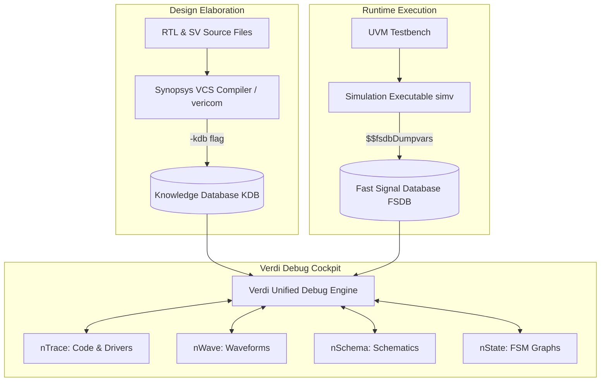
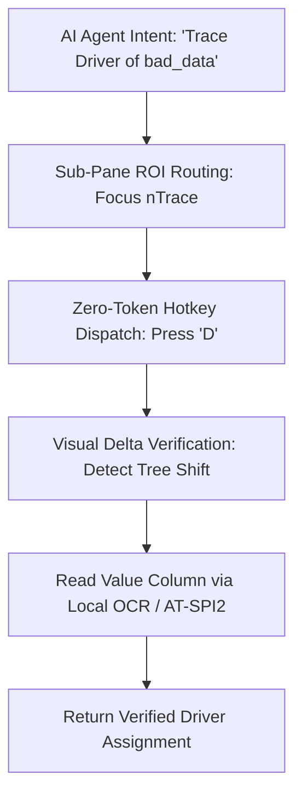

<!-- GENERATED by scripts/build_skill_refs.py from research/verdi_tool_features_and_ai_automation.md. Edit the source, then rerun. -->

---
title: Synopsys Verdi Tool Features & AI Agent Automation Blueprint
tags:
  - type/research
  - domain/eda
  - domain/hardware-verification
  - tools/verdi
  - tools/vcs
  - topic/ui-plugins
aliases:
  - Verdi Tool Guide
  - Synopsys Verdi Debug Blueprint
created: 2026-10-25
updated: 2026-10-25
related:
  - "[[INDEX]]"
  - "[[ui_tool_plugin_architecture]]"
  - "[[phase2_chrome_browser_tool]]"
  - "[[../learnings/verdi_and_complex_eda_ui_automation]]"
---

# ⚡ Synopsys Verdi Tool Features & AI Agent Automation Blueprint

Synopsys Verdi is the industry-standard debug environment for complex ASIC, SoC, and FPGA hardware designs. Unlike general-purpose software IDEs, Verdi couples a statically compiled structural database (KDB) with a compressed temporal simulation trace (FSDB), enabling instantaneous cross-probing across RTL source code, multi-gigabyte waveforms, gate-level schematics, and finite state machines (FSMs).

This document serves as both a comprehensive feature reference for verification engineers and an architectural specification for automating Verdi using the **Vision Control MCP** and Multimodal AI Orchestrators.

---

## 1. Core Architectural Engines: KDB & FSDB



### 1.1 Knowledge Database (KDB)
* **Definition**: A pre-compiled representation of the complete design Abstract Syntax Tree (AST), hierarchy trees, module connectivity, parameter definitions, and SystemVerilog data types.
* **Generation**: Generated during VCS compilation using the `-kdb` flag or standalone via `vericom -sv -f rtl_filelist.f`.
* **Value for Agents**: Enables instant hierarchy and net tracing without re-parsing raw RTL text files.

### 1.2 Fast Signal Database (FSDB) vs. VCD
* **VCD (Value Change Dump)**: Uncompressed ASCII format defined in IEEE 1364. File sizes frequently exceed 50–200 GB, causing simulation bottlenecks and multi-minute GUI load times.
* **FSDB (Fast Signal Database)**: Proprietary, highly compressed binary format (typically **5–10x smaller** than VCD).
* **Random Seeking**: Features tree-indexed chunking, allowing Verdi to seek to any simulation timestamp (e.g. at 5,000,000 ns) in milliseconds without loading the entire dump into RAM.
* **Testbench Dumping**:
  ```systemverilog
  initial begin
    $fsdbDumpvars(0, top_tb, "+all");
    $fsdbDumpSVA(); // Dumps SystemVerilog assertion events
    $fsdbDumpon();
  end
  ```

---

## 2. The Four Pillars of Verdi Debug

### 2.1 nTrace (Source Code Browser & Active Tracing)
`nTrace` is the central navigation hub. Every token in the editor is semantically bound to the KDB and simulation trace:
* **Active Annotation (`X` key)**: Displays the exact simulation value of every net or variable directly beside its identifier in the RTL at the current active waveform cursor time.
* **Driver / Load Tracing (`D` / `L` keys)**:
  * Double-clicking a net or pressing `D` traces backward through multiple module hierarchy levels to locate all driving assignments.
  * Pressing `L` enumerates all downstream fanout loads.
* **Active Trace (`Trace -> Active Trace`)**: Evaluates RTL control expressions (`if/else`, `case`) at the current timestamp, highlighting the executed branch in green while graying out unreached code.

### 2.2 nWave (Waveform Analysis & Signal Organization)
* **Signal Grouping & Bus Formatting**: Groups related signals into logical buses (e.g., AXI read/write channels) with customizable radices (Hex, Dec, Bin, ASCII, or user-defined SystemVerilog `enum` state names).
* **Time Markers (`Shift + M`)**: Places named vertical reference cursors to measure latency, delta times, and clock counts between events.
* **Transition Search (`N` / `P`)**: Quickly advances the primary cursor to the Next (`N`) or Previous (`P`) value transition or glitch.
* **Dynamic FSDB Reload (`L`)**: Reloads updated simulation trace data on the fly while preserving zoom level, signal ordering, and markers.

### 2.3 nSchema (On-the-Fly Schematic Extraction)
* Synthesizes readable gate-level and block-level schematics directly from RTL.
* **Cone-of-Logic Debug**: Extracts only the combinational logic driving a failing flip-flop input, eliminating visual clutter from the rest of the block.
* **Cross-Probing**: Clicking a logic gate in `nSchema` instantly highlights its corresponding RTL code in `nTrace` and pulls its pin signals into `nWave`.

### 2.4 nState (FSM Extraction & Analysis)
* Automatically extracts finite state machine variables into interactive bubble diagrams.
* Generates state transition matrices and state condition tables.
* Synchronizes with `nWave` to animate state transitions dynamically across clock edges.

---

## 3. Advanced Verification Capabilities

### 3.1 Temporal Flow View (TFV) — Causality & X-Propagation Debug
* Traces causality backwards across **both space (combinational gates) and time (clock edges)**.
* **Trace X**: Right-clicking an unknown `X` value on a bus and selecting `Trace -> Trace X` constructs a directed causality graph showing which uninitialized flip-flop latched `X` cycles earlier.

### 3.2 Transaction & UVM Debug (Verification Cockpit)
* **SmartLog**: Aggregates all `uvm_info`, `uvm_warning`, and `uvm_error` log statements. Clicking an error line immediately synchronizes `nWave` to the exact failure timestamp and displays the corresponding SystemVerilog testbench class in `nTrace`.
* **Transaction Stream View**: Renders UVM sequence items (e.g., Ethernet packets, PCIe transactions) as colored horizontal lifespan spans in `nWave` rather than raw low-level pin toggles.

### 3.3 Siloti (Visibility Automation)
* Synthesizes and captures only the essential state elements (flip-flops, memories) during simulation, and uses the structural database to dynamically reconstruct all combinational nets on demand during debug.
* Cuts simulation dumping overhead and disk space requirements by up to **80%**.

---

## 4. Key Shortcuts & CLI Reference

### Essential Hotkeys
| Scope | Hotkey | Action | Menu Path |
| :--- | :--- | :--- | :--- |
| **nTrace** | `Ctrl + W` | Send selected signal(s) to active nWave window | `Tools -> New Waveform` |
| **nTrace** | `X` | Toggle live Active Annotation (simulation values) | `Source -> Active Annotation` |
| **nTrace** | `D` / `L` | Trace Driver (`D`) or Load (`L`) of net | `Trace -> Driver / Load` |
| **nTrace** | `Ctrl + F` | Search text in source file | `Source -> Find...` |
| **nTrace** | `Shift + S` | Find Scope / Instance across hierarchy | `Source -> Find Scope/Signal` |
| **nWave** | `G` | Open Get Signals dialog | `Signal -> Get Signals...` |
| **nWave** | `Z` / `Shift + Z` | Zoom In / Zoom Out around cursor | `View -> Zoom In / Zoom Out` |
| **nWave** | `F` | Zoom Full (fit entire simulation range) | `View -> ZoomAll` |
| **nWave** | `N` / `P` | Jump cursor to Next (`N`) or Previous (`P`) transition | `Search -> Next / Previous` |
| **nWave** | `Shift + M` | Set named Time Marker at cursor | `Waveform -> Marker -> Set` |
| **nWave** | `L` | Reload FSDB file (preserving layout) | `File -> Reload` |

### CLI Invocation Commands
```bash
# 1. Standard invocation with compiled KDB and simulation trace
verdi -dbdir ./simv.daidir -ssf ./top_sim.fsdb &

# 2. Standalone RTL inspection without pre-compiled VCS directory
verdi -sv -f rtl_filelist.f -top top_module &

# 3. Restore a saved session file (window arrangement, signal list, markers)
verdi -dbdir ./simv.daidir -ssf ./top_sim.fsdb -play restore_session.rc &

# 4. Standalone utility commands
fsdbdebug -info ./top_sim.fsdb          # Inspect timestamp range and signal count
fsdb2vcd ./top_sim.fsdb -o out.vcd      # Convert FSDB to VCD if needed
```

---

## 5. Architectural Blueprint for AI Vision & MCP Automation

Automating complex EDA tools like Verdi presents unique challenges due to dense multi-pane interfaces, nested docks, and high-frequency visual information. The following design principles must be enforced:



### 1. Docked Layout Enforcement
* Floating child windows confuse coordinate mapping and spatial bounding boxes.
* The agent startup script must trigger `Window -> Dock All` to guarantee predictable sub-pane layout grids.

### 2. High-Contrast Radix & Trace Line Rendering
* Configure `.synopsys_verdi.setup` to render thick signal traces and explicit Hexadecimal or symbolic Enum radices against clean background colors.

### 3. Coordinate-Free Hotkey Dispatch over Toolbar Hunting
* Avoid attempting Set-of-Marks or CV clicks on tiny $16 \times 16$ pixel toolbar icons.
* Route focus directly to the target sub-pane (`nTrace`, `nWave`, or `nSchema`), then issue deterministic keyboard shortcuts (`Ctrl+W`, `D`, `X`, `F`).

### 4. Reading Value Columns over Waveform Pixel Inspection
* Always enable `View -> Signal Value` in `nWave`.
* Reading the numerical/hex text in the value column at the active cursor provides 100% ground-truth accuracy, eliminating fragile pixel-level transition decoding.
