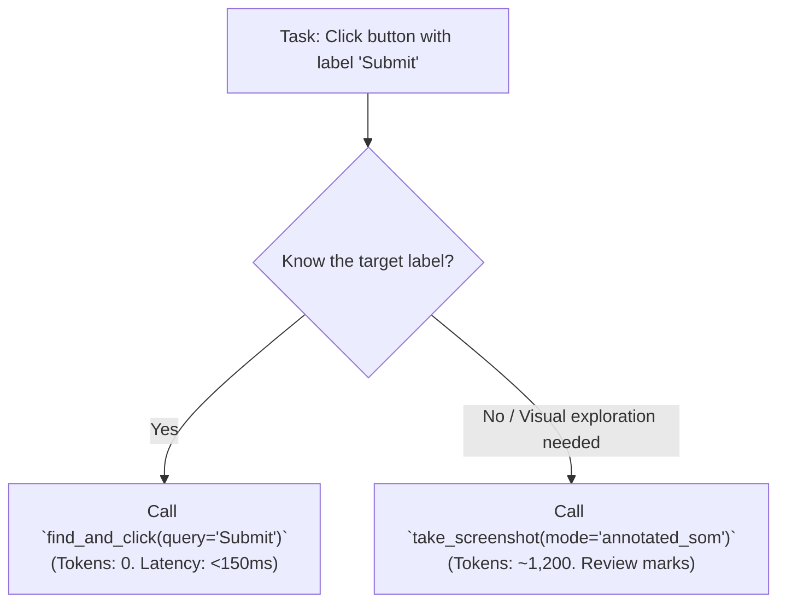

<!-- GENERATED by scripts/build_skill_refs.py from learnings/zero_token_element_discovery.md. Edit the source, then rerun. -->

---
title: Zero-Token Element Discovery & Compound Actions
tags:
  - learnings/token-efficiency
  - technique/zero-token
  - technique/compound-actions
  - tool/find-element
  - tool/click-and-type
aliases:
  - Zero-Token Discovery
  - Compound Actions Heuristics
created: 2026-10-25
updated: 2026-10-25
related:
  - "[[INDEX]]"
  - "[[../research/token_optimization_and_cost_dynamics]]"
  - "[[browser_interaction_recipes]]"
---

# Zero-Token Element Discovery & Compound Actions

## 1. The Zero-Token Principle

Before capturing a 1600px or 4K screenshot that consumes 1,200+ multimodal LLM tokens, query the underlying accessibility and visual caches using semantic text filters:



---

## 2. Best-Practice Heuristics

### A. One-Shot Form Automation via `click_and_type`
Rather than executing 4 sequential tool calls:
1. `click(x, y)` $\rightarrow$ wait $\rightarrow$ verify
2. `hotkey("ctrl+a")` $\rightarrow$ wait
3. `press_key("backspace")` $\rightarrow$ wait
4. `type_text("search query", press_enter=True)` $\rightarrow$ wait $\rightarrow$ verify

Use the atomic compound primitive:
```python
click_and_type(
    query="Ask Gemini",
    text="My complex research query",
    clear_first=True,
    press_enter=True,
    verify_delta=True
)
```
* **Benefits**: Cuts round-trips from 4 to 1, reduces tool token overhead by 75%, and guarantees focus before typing.

### B. Finding and Clicking Without Coordinates
```python
# Clicks the button matching '4 Argon' automatically:
find_and_click(query="4 Argon")
```
* Queries the AT-SPI2 semantic tree directly.
* Resolves the element's centroid $(x, y)$ in physical desktop coordinates.
* Executes the click and verifies visual delta.
