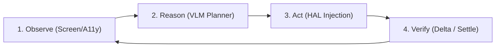

# AI Orchestrators and Vision Control Architectures

## 1. Overview & Problem Definition

Standard automation engines rely on static selectors (DOM IDs, XPath, accessibility identifiers). In modern desktop operating systems, canvas-based web apps, remote desktops (Citrix/VNC), and cross-platform Electron applications, selectors frequently mutate, break, or are completely absent.

**Vision Control + AI Orchestration** solves this by establishing an agentic **closed-loop feedback pipeline**:

---

## 2. Component Deconstruction

### A. The Multimodal Orchestrator (Decision Engine)
* **Loop Mechanics**: Coordinates multi-step reasoning using paradigms like **ReAct** (*Reason $\rightarrow$ Act $\rightarrow$ Observe*).
* **State Management**:
  * Tracks sub-goal progress across multi-turn trajectories.
  * Manages active window contexts and application states.
  * Decides when a step has failed or when unexpected obstruction modals (e.g. cookie banners, notification requests) must be handled first.
* **Model Classes**: Multimodal LLMs/VLMs capable of interleaving high-resolution visual tokens with structured tool invocation schemas (e.g., Gemini 2.0 Flash / Pro / Argon, Claude 3.5 Sonnet, GPT-4o).

### B. Perception & Grounding Layer
* Captures raw framebuffers and runs structural introspection (AT-SPI2 / OS accessibility tree).
* Normalizes coordinates across varied resolutions (DPI scaling, 4K, multi-monitor).
* Generates indexed Set-of-Marks (SoM) badges to translate continuous $(x, y)$ coordinate predictions into discrete integer IDs.

### C. Execution Environment & Runtimes
* Programmatic bridges (Python `pynput`, `pyautogui`, `Xlib`, Node.js `robotjs`, `playwright`).
* Synthesizes native display server input events (`mousedown`, `mouseup`, `keydown`, `keyup`, `scroll`) at the OS driver layer.

### D. Verification Feedback Loop
* Compares pre-action and post-action visual states ($\Delta_{ratio}$).
* Prevents cascading failures by halting or retrying when an action resulted in a zero delta.

---

## 3. Key Failure Modes & Mitigations

| Failure Mode | Root Cause | Architectural Mitigation |
| :--- | :--- | :--- |
| **Coordinate Drift** | Non-standard DPI scaling or downsampled screenshot resizing | Invert scaling factor deterministically back to physical display resolution before dispatching clicks. |
| **Action Cascading** | Blind open-loop execution (assuming click succeeded) | Automated pre/post visual delta check (`verify_delta=True`). |
| **Context Window Blowup** | Storing dozens of full 4K screenshot images in chat memory | Sliding visual window ($N \le 3$) and zero-token semantic queries (`find_element`). |
| **Window Focus Loss** | Clicking before target window has received input focus | Explicit window focus verification and stack-raising (`focus_window`). |
