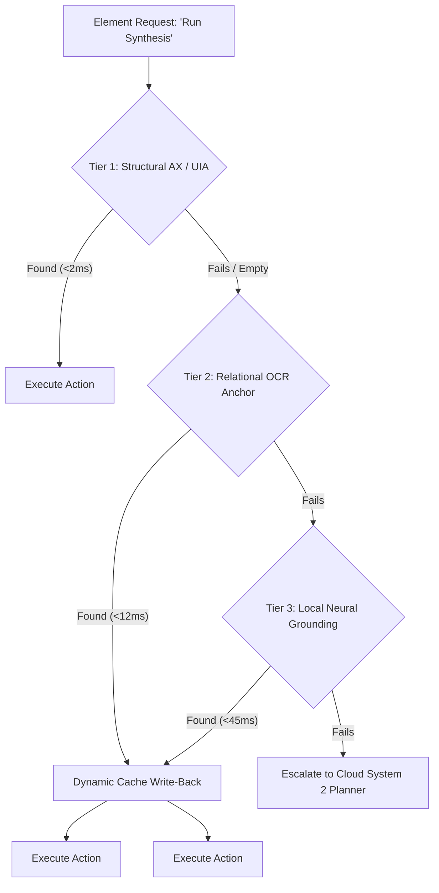
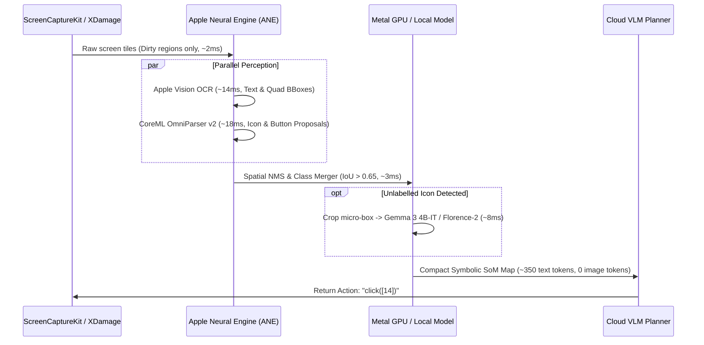
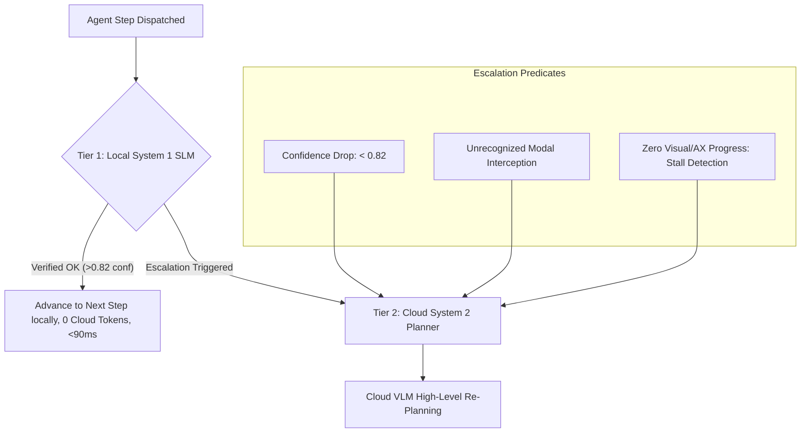

# Round 5 Architecture: Production Maintainability, Modular Codebase, and Local Model Token Reduction

> **Source:** Extracted from deep-research session with **Gemini 4 Argon** in the native Gemini desktop app (*building and maintaining the "desktop-control" MCP server*).
> **Objective:** Transitioning `desktop-control` MCP from a monolithic tool server into a production-grade, bicameral, capability-gated microkernel that isolates OS-specific bindings, dynamically mutates tool catalogs, and leverages on-device SLMs (Gemma 3 4B-IT, CoreML OmniParser v2, Apple Vision OCR) as an asymmetric local shield to cut cloud token spend by 85–92%.

---

## Executive Summary

Scaling a computer-use MCP server past 40 primitives while suppressing quadratic multi-turn cloud costs requires transitioning from a monolithic tool server to a **bicameral, capability-gated microkernel**.

By isolating OS-specific bindings behind strict protocol-driven HAL contracts, serving compressed tool profiles that dynamically mutate via MCP `notifications/tools/list_changed`, and positioning local Apple Neural Engine (ANE) / GPU models (CoreML OmniParser v2, Apple Vision OCR, and quantized Gemma 3 4B-IT) as a "System 1" perceptual and verification shield, engineering teams can:
1. **Reduce cold-start prompt overhead under 900 tokens** (down from 5,400+ tokens for 45 full schemas).
2. **Cut multi-turn cloud token consumption by 85%–92%** via local history compaction and local verification.
3. **Eliminate VRAM thrashing on developer laptops** by partitioning compute between the ANE (~190MB) and Metal GPU (~3.1GB), keeping total local footprint under 3.3GB unified memory.

---

## Pillar 1: Long-Term Maintenance & Codebase Structure of `desktop-control` MCP

### 1. Modular Platform HAL & Headless CI Architecture
To prevent `ImportError` cascades when running Linux CI containers against macOS (`pyobjc`/`Quartz`) or Windows (`pywin32`/`comtypes`) code, the Hardware Abstraction Layer must enforce zero top-level OS imports outside platform implementation modules, backed by `@runtime_checkable` `typing.Protocol` contracts and a lazy factory loader.

```
vision_mcp/hal/
├── protocols.py       # Zero-dependency Protocol definitions (IScreenCapture, IInputDriver, IAXTreeDriver, IWindowManager)
├── factory.py         # Lazy OS detection and dynamic import
├── macos.py           # Quartz, CGEvent, ScreenCaptureKit, ApplicationServices (macOS only)
├── linux_x11.py       # X11, XDamage, XFixes, AT-SPI2 D-Bus (Linux only)
├── linux_wayland.py   # Wayland Portal / wlr-foreign-toplevel (Linux Wayland)
├── win_uia.py         # pywin32, comtypes UI Automation (Windows only)
└── mock_replay.py     # Deterministic cassette-based HAL for headless CI
```

- **Protocol Segregation (`protocols.py`):** Split `IDesktopHAL` into four composable sub-protocols:
  - `IScreenCapture`: frame capture + dirty-region damage rectangles via `XDamage` / `CGDisplayStream`.
  - `IInputDriver`: Bezier-interpolated cursor motion, hardware keycodes, Unicode text injection.
  - `IAXTreeDriver`: accessibility tree extraction + transactional diffing.
  - `IWindowManager`: PID-to-window enumeration, Z-order focus, DPI scaling factors.
- **Coordinate Normalization Invariant:** Every HAL backend must ingest and emit coordinates strictly in **Normalized Logical Space `[0.0, 1.0]`** (or integer `[0, 1000]`) relative to the target window or primary display, accompanied by an explicit `DisplayMetrics(logical_width, logical_height, backing_scale_factor)` struct. Retina 2.0x backing store scaling on macOS (`CGWindowListCreateImage` vs `CGEventCreateMouseEvent` logical points) and Windows per-monitor DPI awareness are resolved strictly inside the HAL boundary.
- **Deterministic Headless CI without Xvfb/WindowServer:** While `Xvfb` works for basic Linux X11 tests, it cannot replicate macOS `AXUIElement` quirks or Windows UIA COM trees. Implement `MockReplayHAL` driven by recorded **State Cassettes (`.halpack` archives)** containing WebP keyframes, serialized `AXNode` JSON trees, and OCR bounding box ground truth. Every real execution in staging dumps a transition tuple `(PreState, ActionPrimitive, PostState)` into a fixture, allowing `pytest` in standard GitHub Actions runners to validate VDOM diffing, modal triage, and zoom cropping in milliseconds without a display server.

---

### 2. MCP Tool Catalog Modularization & Deferred Schema Loading
Loading 45 full JSON Schemas into Claude Desktop or an IDE agent consumes ~5,400 tokens upfront before the user types a single word. Modularizing the catalog requires a tiered exposure strategy:

| Profile / Mode | Active Tools | Injected Token Footprint | Mutation / Trigger Mechanism | Target Workflow |
| :--- | :--- | :--- | :--- | :--- |
| **`minimal_computer_use`** | `take_screenshot`, `click`, `type_text`, `hotkey`, `scroll` (5 core tools) | **~680 tokens** | Default cold-start profile on startup | Simple single-window navigation, web forms |
| **Domain-Gated Toolsets** | Core + Domain tools (`window_mgmt`, `developer`, `eda_vivado`, `eda_verdi`) | **~1,200–1,800 tokens** | Injected on-demand when agent focuses matching application | Specific app automation (Vivado synthesis, Chrome CDP) |
| **Dynamic Capability Escalation** | 5 core + 2 meta tools (`manage_toolsets`, `execute_trajectory`) | **~850 tokens** | `enable_toolset(domains=[...])` mutates registry & fires `notifications/tools/list_changed` | Multi-app autonomous agent sessions |
| **File/Resource Out-of-Band (`--output-mode file`)** | 5 core tools | **~600 tokens** | Large payloads written to RAM-backed `/tmp/dc_state/`; MCP returns 80-token URI pointer | High-frequency VDOM/OCR loops |

#### Out-of-Band Large Payload Offloading:
Instead of dumping 2,000-line accessibility trees or full OCR lists into conversation history, write the structured JSON/Markdown payload to a RAM-backed tmpfs directory (`/dev/shm/dc_state/` on Linux, `/tmp/dc_state/` on macOS) and return an **80-token summary header**:
```json
{
  "status": "success",
  "active_window": "Vivado 2025.1",
  "nodes_count": 342,
  "resource_uri": "mcp://desktop-control/state/latest_ax_diff.json",
  "offloaded": true,
  "estimated_tokens_saved": 1850
}
```
The agent reads specific sub-slices or greps matching elements on demand.

---

### 3. Application Plugin Architecture Evolution
Enterprise EDA tools (Xilinx/AMD Vivado, Synopsys Verdi) and complex desktop suites frequently break static automation scripts because Qt/Java Swing sub-panes lack stable accessibility roles, and users switch between Dark/Light themes or resize docked sub-windows.



- **Declarative Plugin Manifests with Version SemVer Ranges:** Define plugins in declarative YAML/Pydantic specs (`plugins/vivado_2024_2.yaml`) with explicit version matchers (`app_version: ">=2023.1, <2025.0"`), layout landmarks, and modal handler rules.
- **Theme-Agnostic Self-Healing:** Standard RGB template matching (`cv2.matchTemplate`) fails when a user toggles from Light to Dark theme. Replace RGB templates with **Normalized Gradient Magnitude / Canny Edge Maps** or **Local Binary Patterns (LBP)** for deterministic icon matching, combined with Relational OCR Anchoring (e.g., *"the icon 24px to the left of the text label 'Run Synthesis'"*). When Tier 1 fails and Tier 2/3 succeeds, the plugin automatically patches its runtime selector cache and logs a telemetry drift warning.

---

## Pillar 2: Slashing Cloud AI Tokens Using Local Models (Gemma 3 & Local SLMs)

### 1. Asymmetric Local Perception & Coordinate Grounding (Sub-50ms Pipeline)
Sending 4K screenshots ($3840 \times 2160$) to frontier cloud VLMs costs 1,500–3,200 input tokens per turn and suffers from $\pm 18\text{px}$ spatial regression jitter on dense toolbars. Instead, convert continuous coordinate regression into discrete symbolic Set-of-Marks (SoM) ID selection entirely on-device.



#### Three-Stream Fusion & Priority Non-Maximum Suppression (NMS):
1. **Stream A (AX Tree, ~1ms):** Extracts exact bounding boxes for native OS controls.
2. **Stream B (Apple Vision `VNRecognizeTextRequest` / RapidOCR, ~14ms):** Extracts text strings and tight quad boxes.
3. **Stream C (CoreML OmniParser v2, YOLOv11-UI compiled to `mlmodelc` FP16 on ANE, ~18ms):** Detects micro-icons, toolbars, and unlabelled buttons.
4. **Spatial NMS Merger:** Fuses all three streams with class priority `AX > OCR > Vision Icon` at $\text{IoU} > 0.65$, emitting discrete numeric tags (`[1]`, `[2]`, `[14]`). The cloud model selects an integer ID instead of predicting floating-point coordinates.

---

### 2. Local History Compaction & Memory Distillation
In a 30-turn desktop trajectory, raw message history accumulates 60,000+ tokens of stale VDOM diffs, tool outputs, and reasoning traces. By intercepting the conversation state inside the MCP harness before cloud dispatch, a local **Gemma 3 4B-IT** (Q4_K_M, running via `llama-server` or Ollama) compresses turns $1 \dots N-3$ into a deterministic **450-token structured state checkpoint** at **$0.00 cloud cost**.

#### The 8-Part Invariant `COMPACT_PROMPT` Contract for Local Gemma 3:
```markdown
You are a deterministic Desktop Trajectory State Compressor. Compress turns 1..N-3 into:
1. [USER_INSTRUCTIONS]: Verbatim core goal and success criteria.
2. [TASK_TEMPLATE]: Active sub-goal checklist with [x] completed, [/] in-progress, [ ] pending.
3. [CONSTRAINTS]: Hard guardrails (forbidden actions, read-only paths, rate limits).
4. [ACTIONS_TAKEN]: Chronological log of compacted turns (e.g., "T1: Focused Vivado -> T2: Opened FIFO wizard").
5. [ERRORS_AND_FIXES]: Failed actions, exact error messages, and verified corrective workarounds.
6. [PROGRESS_METRICS]: Quantitative completion state (e.g., "2/5 synthesis steps converged").
7. [CURRENT_SCREEN_STATE]: Active window, focused sub-pane, modal status, cursor coordinates.
8. [NEXT_IMMEDIATE_STEP]: Exact preconditions and recommended next primitive.
```

- **Trigger Policy:** Execute local compaction asynchronously whenever `estimated_context_tokens > 12,000` or every 6 trajectory batches. Always retain the last 2 raw turns uncompacted so the cloud planner retains immediate visibility into momentum.

---

### 3. Local State Verification & System 1 / System 2 Bicameral Routing
Over 75% of computer-use turns are routine mechanical progressions: clicking a known button, dismissing a cookie/license dialog, waiting for a progress bar, or verifying that a menu opened. Calling Claude Sonnet/Opus or Gemini Pro for these turns wastes 2–4 seconds of latency and $0.03–$0.08 per step.



#### Escalation Predicates:
1. **Confidence Drop:** Local Gemma 3 outputs a JSON verdict with `"confidence": <float>` (calibrated against token logprobs). Any score below 0.82 triggers immediate cloud escalation.
2. **Unrecognized Modal Interception:** A new high-Z-order window appears (`AXDialog` / `WM_TRANSIENT_FOR`) that does not match the plugin's known allowlist (e.g., unexpected DRC syntax failure vs. benign "Overwrite file?").
3. **Zero Visual/AX Progress (Stall Detection):** After executing an action, both the structural AX diff is empty and the target ROI's perceptual pixel diff ($\Delta L_1$) is below 0.005 after a single local retry.

---

### 4. VRAM and Compute Partitioning on Developer Laptops
Running ONNX/CoreML detectors alongside a 4B–7B vision-language model on a 16GB–32GB MacBook Pro or Linux workstation will cause swap thrashing if both frameworks compete for the same GPU command queue.

#### Hardware Compute Partitioning (Apple Silicon Unified Memory):
- **Apple Neural Engine (ANE):** Pin Apple Vision OCR and CoreML OmniParser v2 (`MLComputeUnits.cpuAndNeuralEngine`) strictly to the 16-core ANE. The ANE operates on its own dedicated compute fabric (~190MB memory footprint) without contending for Metal GPU shader cores or memory bandwidth.
- **Metal GPU:** Pin Gemma 3 4B-IT (Q4_K_M, ~2.6GB weights + 512MB KV cache) to Metal GPU via `llama-server` / Ollama with `-ngl 99`.
- **Total Local Footprint:** **Under 3.3 GB of unified memory**, leaving 28+ GB for IDEs, compilers, and EDA simulators.

---

## Pillar 3: Concrete Implementation Blueprints

### Blueprint 1: `ToolSetManager` with Capability Escalation & Out-of-Band File Offloading

```python
from __future__ import annotations
import hashlib
import json
import os
import tempfile
from dataclasses import dataclass, field
from enum import Enum
from pathlib import Path
from typing import Any, Awaitable, Callable, Dict, List, Optional, Protocol
from pydantic import BaseModel, Field

class OutputMode(str, Enum):
    INLINE = "inline"
    FILE = "file"          # Writes large outputs to tmpfs, returns compact file URI
    RESOURCE = "resource"  # Exposes via mcp://desktop-control/state/<id>

class ToolDefinition(BaseModel):
    name: str
    domain: str = Field(description="Capability group: 'core', 'developer', 'window_mgmt', 'eda_vivado', 'eda_verdi'")
    description: str
    input_schema: Dict[str, Any]
    handler: Callable[..., Awaitable[Dict[str, Any]]] = Field(exclude=True)
    max_inline_tokens: int = 350

class ManageToolsetsInput(BaseModel):
    action: str = Field(pattern="^(list_domains|enable|disable)$")
    domains: List[str] = Field(default_factory=list, description="Domains to enable or disable")

class ToolSetManager:
    """
    Dynamically exposes tool subsets to MCP clients to eliminate prompt bloat.
    Emits notifications/tools/list_changed when capabilities escalate.
    """
    PROFILES: Dict[str, List[str]] = {
        "minimal_computer_use": ["core"],
        "full_developer": ["core", "developer", "window_mgmt"],
        "eda_automation": ["core", "developer", "window_mgmt", "eda_vivado", "eda_verdi"],
    }

    def __init__(
        self,
        initial_profile: str = "minimal_computer_use",
        output_mode: OutputMode = OutputMode.FILE,
        notify_tools_changed_cb: Optional[Callable[[], Awaitable[None]]] = None,
        state_dir: Optional[Path] = None,
    ) -> None:
        self._registry: Dict[str, ToolDefinition] = {}
        self._active_domains: set[str] = set(self.PROFILES.get(initial_profile, ["core"]))
        self._output_mode = output_mode
        self._notify_cb = notify_tools_changed_cb
        self._state_dir = state_dir or Path(tempfile.gettempdir()) / "dc_state"
        self._state_dir.mkdir(parents=True, exist_ok=True)

    def register_tool(self, tool: ToolDefinition) -> None:
        self._registry[tool.name] = tool

    def get_active_mcp_schemas(self) -> List[Dict[str, Any]]:
        """Returns ONLY schemas for currently active domains, keeping prompt prefix small."""
        return [
            {
                "name": tool.name,
                "description": tool.description,
                "inputSchema": tool.input_schema,
            }
            for tool in self._registry.values()
            if tool.domain in self._active_domains
        ]

    async def manage_toolsets(self, req: ManageToolsetsInput) -> Dict[str, Any]:
        available_domains = {t.domain for t in self._registry.values()}
        if req.action == "list_domains":
            return {
                "active_domains": sorted(self._active_domains),
                "available_domains": sorted(available_domains),
            }

        mutated = False
        for dom in req.domains:
            if req.action == "enable" and dom in available_domains and dom not in self._active_domains:
                self._active_domains.add(dom)
                mutated = True
            elif req.action == "disable" and dom in self._active_domains and dom != "core":
                self._active_domains.discard(dom)
                mutated = True

        if mutated and self._notify_cb is not None:
            await self._notify_cb()  # Signals notifications/tools/list_changed

        return {
            "success": True,
            "mutated": mutated,
            "active_domains": sorted(self._active_domains),
            "active_tool_count": len(self.get_active_mcp_schemas()),
        }

    def format_output(self, tool_name: str, payload: Dict[str, Any]) -> Dict[str, Any]:
        """Intercepts large payloads and offloads them to out-of-band files/resources."""
        serialized = json.dumps(payload, indent=2)
        est_tokens = len(serialized) // 4
        tool = self._registry.get(tool_name)
        threshold = tool.max_inline_tokens if tool else 350

        if self._output_mode == OutputMode.INLINE or est_tokens <= threshold:
            return payload

        # Offload to disk/tmpfs
        h = hashlib.sha256(serialized.encode()).hexdigest()[:12]
        filename = f"{tool_name}_{h}.json"
        artifact_path = self._state_dir / filename
        artifact_path.write_text(serialized, encoding="utf-8")

        summary_keys = ["status", "active_window", "is_error", "modal_state", "count"]
        compact_preview = {k: payload[k] for k in summary_keys if k in payload}

        return {
            "offloaded": True,
            "estimated_tokens_saved": max(0, est_tokens - 60),
            "file_path": str(artifact_path),
            "resource_uri": f"mcp://desktop-control/state/{filename}",
            "preview": compact_preview,
            "read_hint": f"Call read_file(path='{artifact_path}') or grep specific keys on demand.",
        }
```

---

### Blueprint 2: `BicameralStepController` (System 1 Local Shield + System 2 Cloud Escalation)

```python
from __future__ import annotations
import asyncio
from enum import Enum
from typing import Any, Dict, List, Optional
from pydantic import BaseModel, Field

class VerificationTier(str, Enum):
    TIER0_DETERMINISTIC = "tier0_deterministic_ocr_ax"
    TIER1_LOCAL_SLM = "tier1_local_gemma3"
    TIER2_CLOUD_VLM = "tier2_cloud_planner"

class StepExecutionVerdict(BaseModel):
    success: bool
    tier_used: VerificationTier
    escalated_to_cloud: bool = False
    confidence: float = Field(ge=0.0, le=1.0)
    reason: str
    tokens_consumed: int = 0  # 0 for Tier 0/1; >0 for Tier 2

class BicameralStepController:
    """
    Coordinates local System 1 verification against routine actions,
    escalating to Cloud System 2 planner only when ambiguity or failure occurs.
    """
    def __init__(self, hal, local_gemma_client, cloud_vlm_client):
        self.hal = hal
        self.gemma = local_gemma_client
        self.cloud_vlm = cloud_vlm_client

    async def execute_step_with_bicameral_guard(
        self,
        action_name: str,
        action_args: Dict[str, Any],
        expected_outcome: Dict[str, Any],
    ) -> StepExecutionVerdict:
        # 1. Execute action physically via HAL
        await self.hal.dispatch_action(action_name, action_args)
        
        # 2. Tier 0: Deterministic Post-Check (Zero tokens, <20ms)
        ax_diff = await self.hal.get_ax_tree_diff(diff_only=True)
        if "assert_screen_text" in expected_outcome:
            target_str = expected_outcome["assert_screen_text"]
            ocr_res = await self.hal.read_screen_text(contains=target_str)
            if ocr_res.get("count", 0) > 0:
                return StepExecutionVerdict(
                    success=True,
                    tier_used=VerificationTier.TIER0_DETERMINISTIC,
                    confidence=1.0,
                    reason=f"Tier 0 match: Text '{target_str}' confirmed on screen",
                    tokens_consumed=0,
                )

        # 3. Tier 1: Local System 1 SLM Evaluation (Gemma 3 4B-IT, <90ms, $0)
        local_eval = await self.gemma.evaluate_step_quiescence(
            action=action_name,
            expected=expected_outcome,
            ax_diff=ax_diff,
        )
        if local_eval["verified"] and local_eval["confidence"] >= 0.82:
            return StepExecutionVerdict(
                success=True,
                tier_used=VerificationTier.TIER1_LOCAL_SLM,
                confidence=local_eval["confidence"],
                reason=f"Tier 1 SLM verified: {local_eval['reason']}",
                tokens_consumed=0,
            )

        # 4. Tier 2: Cloud System 2 Escalation (Cloud VLM Planner)
        cloud_eval = await self.cloud_vlm.diagnose_and_replan(
            action=action_name,
            expected=expected_outcome,
            reason=f"Local confidence low ({local_eval.get('confidence', 0.0)}): {local_eval.get('reason')}",
        )
        return StepExecutionVerdict(
            success=cloud_eval["success"],
            tier_used=VerificationTier.TIER2_CLOUD_VLM,
            escalated_to_cloud=True,
            confidence=cloud_eval.get("confidence", 0.9),
            reason=cloud_eval.get("reason", "Escalated to cloud planner"),
            tokens_consumed=cloud_eval.get("tokens_billed", 1650),
        )
```

---

### Blueprint 3: Headless E2E Integration Test Harness (`MockReplayHAL`)

```python
from __future__ import annotations
import pytest
from dataclasses import dataclass
from typing import Any, Dict, List

@dataclass
class ScreenFrameState:
    frame_id: str
    ocr_boxes: List[Dict[str, Any]]
    ax_diff: Dict[str, Any]
    pixel_delta_from_prev: float = 0.0

class MockReplayHAL:
    """Replays deterministic recorded state cassettes without requiring physical displays."""
    def __init__(self, states: List[ScreenFrameState]):
        self.states = states
        self.cursor = 0
        self.actions_dispatched = []

    async def dispatch_action(self, action: str, args: Dict[str, Any]):
        self.actions_dispatched.append((action, args))
        if self.cursor < len(self.states) - 1:
            self.cursor += 1

    async def get_ax_tree_diff(self, diff_only: bool = True):
        return self.states[self.cursor].ax_diff

    async def read_screen_text(self, contains: str = None):
        current_boxes = self.states[self.cursor].ocr_boxes
        if contains:
            matched = [b for b in current_boxes if contains.lower() in b.get("text", "").lower()]
            return {"count": len(matched), "lines": matched}
        return {"count": len(current_boxes), "lines": current_boxes}
```

---

## Master Implementation Roadmap: Next-Gen `desktop-control` MCP

1. **Phase 1: HAL Protocol Segregation & Headless Cassette Harness**
   - Break `vision_mcp/hal/base.py` into `@runtime_checkable` `typing.Protocol` interfaces (`IScreenCapture`, `IInputDriver`, `IAXTreeDriver`, `IWindowManager`).
   - Implement `MockReplayHAL` and state cassette fixtures (`.halpack`) for display-free CI runs.
2. **Phase 2: Modular `ToolSetManager` & Out-of-Band File Offloading**
   - Implement domain-gated profiles (`minimal_computer_use`, `full_developer`, `eda_automation`).
   - Wire `--output-mode file` to write large VDOM/AX diffs to `/tmp/dc_state/`, returning compact resource pointers.
3. **Phase 3: Local Gemma 3 Memory Compaction Sidecar**
   - Implement the 8-Part Invariant `COMPACT_PROMPT` worker running on local `llama-server` / Ollama.
   - Trigger local compaction automatically when context reaches 12k tokens, retaining last 2 turns raw.
4. **Phase 4: Bicameral System 1 / System 2 Execution Controller**
   - Implement `BicameralStepController` to intercept routine button clicks and modal verifications locally.
   - Escalate to cloud VLM only on confidence drops (<0.82), unknown modals, or execution stalls.
5. **Phase 5: Declarative Application Plugins & Self-Healing Anchors**
   - Migrate Vivado/Verdi plugins to versioned YAML specs (`plugins/vivado_2024_2.yaml`).
   - Implement Canny edge / gradient magnitude template matching for theme-agnostic icon resolution.

