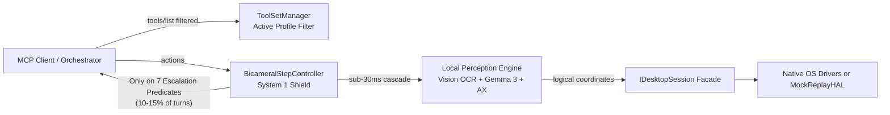
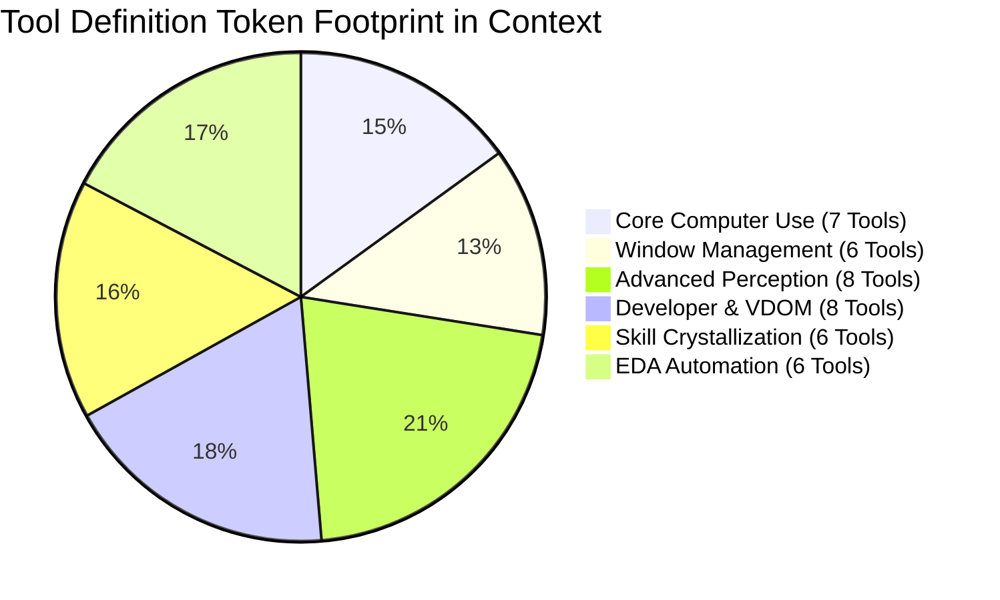
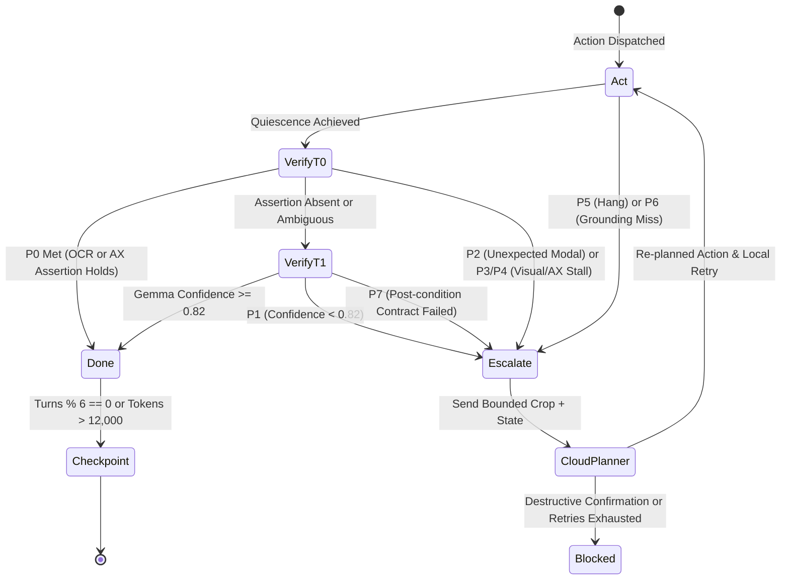
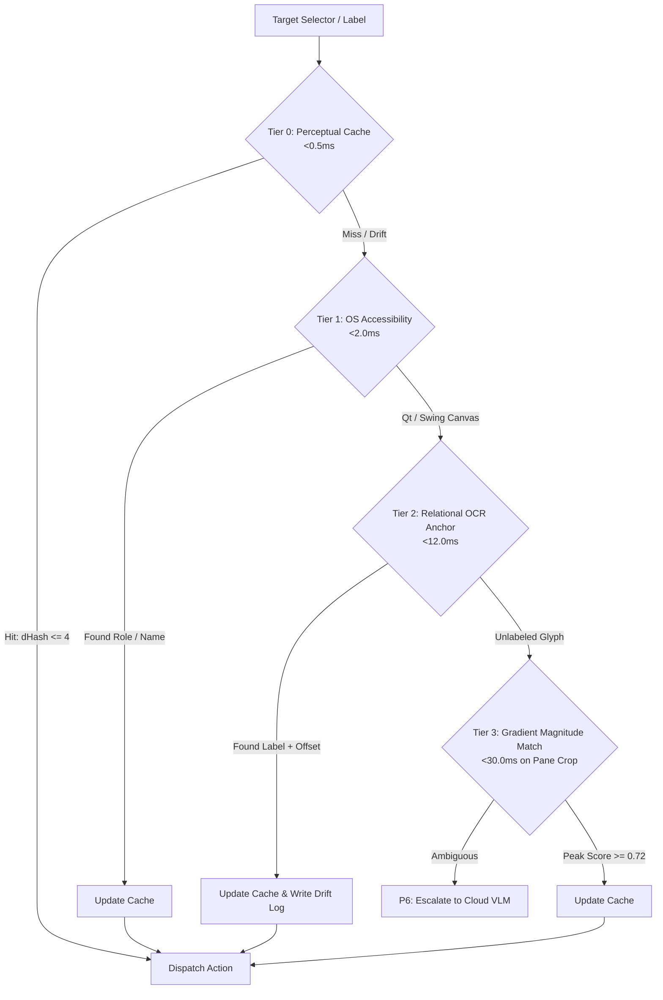

# 📐 Cursor Architecture Specification: Platform HAL, Tool Modularization, Token Economics, and Next-Gen Agents

## Executive Summary & Context

To complement the deep research conducted on the Gemini Desktop App (Gemini 4 Argon), a parallel, codebase-grounded architectural investigation was executed natively inside the **Cursor IDE** on macOS. Cursor analyzed the live `vision_mcp` codebase (incorporating the Round 5 foundational enhancements) using concurrent multi-agent code explorers and formulated a comprehensive architectural blueprint.

Cursor's analysis established a crucial structural observation:
> **The `vision_mcp` library already contains the foundational architectural contracts (`protocols.py`, `mock_replay.py`, `toolset.py`, `bicameral.py`); the live server and execution path (`server.py`, `controller.py`) still lag behind these library contracts by publishing all 41 tools unconditionally and verifying steps primarily on the cloud path.**

This specification codifies Cursor's architectural design, delineating what is already implemented in the library versus what must be wired into the live execution loops to achieve an **85–92% reduction in cloud tokens** and robust sub-30ms desktop automation.



---

## 1. Modular Platform Abstraction and Headless Testing

### 1.1 The Import Firewall & Decoupled Seams

The `vision_mcp/hal/` subpackage establishes an isolated Hardware Abstraction Layer separating OS-specific APIs (`Quartz`/`CGEvent` on macOS, `X11`/`XDamage` on Linux, `pywin32`/`UIAutomation` on Windows) from the core reasoning loop. 

While `vision_mcp/hal/__init__.py` cleanly avoids eager backend imports, three architectural leaks were identified by Cursor:

1. **Protocol Purity:** `vision_mcp/hal/protocols.py` imported `PIL.Image`. In a pure headless CI or microkernel runner, protocol definitions should depend exclusively on Python stdlib and internal schemas (`vision_mcp.types`), utilizing `TYPE_CHECKING` guards for heavy graphical libraries.
2. **Linux Import Seam:** `vision_mcp/hal/linux.py` imported `mss`, `pynput`, and `Xlib` at the module level. Tests collecting `LinuxHAL` on non-Linux CI runners could fail or require dummy stubs.
3. **Server Boot Dependency:** `vision_mcp/server.py` instantiated `get_desktop_hal()` at module import without inspecting environment overrides (`DESKTOP_HAL=replay`), preventing automated server startup against recorded cassettes.

#### Target Microkernel Seam Architecture

```python
def get_desktop_hal(
    kind: str | None = None, 
    cassette: Path | None = None
) -> IDesktopSession:
    """Microkernel factory isolating platform drivers and replay harnesses."""
    kind = kind or os.environ.get("DESKTOP_HAL") or _platform_kind()
    if kind == "replay":
        cassette_path = cassette or Path(os.environ["DESKTOP_CASSETTE"])
        return load_cassette(cassette_path)
    
    module_map = {
        "darwin": "vision_mcp.hal.macos",
        "linux_x11": "vision_mcp.hal.linux_x11",
        "linux_wayland": "vision_mcp.hal.linux_wayland",
        "win32": "vision_mcp.hal.windows",
    }
    backend_module = importlib.import_module(module_map[kind])
    return backend_module.build_hal()
```

#### The `IDesktopSession` Composition Facade

Rather than maintaining a monolithic god-class, the runtime contract is partitioned into composable, single-responsibility protocols:

```python
class IDesktopSession(Protocol):
    """Unified session facade exposing segregated capabilities."""
    capture: IScreenCapture
    input: IInputDriver
    windows: IWindowManager
    ax: IAXTreeDriver
    quiescence: IQuiescenceMonitor
    topology: DisplayTopology
```

When an underlying platform cannot support a specific capability (e.g., AT-SPI on headless Wayland or Accessibility Tree queries on legacy Windows applications), the method raises `CapabilityUnavailable` rather than returning empty lists `[]` or silent falses, ensuring CI test suites fail closed.

---

### 1.2 Coordinate Space & Multi-Monitor Virtual Desktop Topology

A common architectural trap in Computer-Use agents is normalizing coordinates to a unit square $[0.0, 1.0]$. On high-resolution multi-monitor configurations (e.g., dual $5120 \times 2880$ displays), floating-point rounding errors exceed the width of a 16px toolbar icon. Furthermore, secondary displays placed above or to the left of the primary display have negative origin coordinates that cannot be represented in a unit square.

Cursor mandates three distinct coordinate spaces with unambiguous boundary conversions:

```mermaid
flowchart TD
  FB[Backing Pixels\nRaw Framebuffer / High-DPI Camera\nScale = 2.0x Retina / 1.5x Windows]
  -->|Screen / Window Scaler| LGP[Logical Global Points\nVirtual Desktop Points\nInteger (x, y), Negative Origins Supported]
  LGP -->|Tool Result Normalizer| MG[Model Grid\nInteger [0, 1000] relative to Active Window\nUsed exclusively for VLM bbox naming]
  MG -->|Set-of-Marks ID Mapping| SOM[Set-of-Marks IDs\ne.g., 'Click Mark #14'\nBypasses coordinate ambiguity entirely]
```

#### Topology Definition

```python
class DisplayMetrics(BaseModel):
    display_id: str
    origin: tuple[int, int]      # Logical global coordinates (can be negative)
    size: tuple[int, int]        # Logical width, height
    scale: float                 # backing_pixels / logical_point (Retina = 2.0)
    rotation_deg: int = 0

class DisplayTopology(BaseModel):
    displays: list[DisplayMetrics]
    primary_id: str

def logical_to_backing(p: tuple[int, int], d: DisplayMetrics) -> tuple[int, int]:
    lx, ly = p[0] - d.origin[0], p[1] - d.origin[1]
    return (round(lx * d.scale), round(ly * d.scale))
```

#### Driver Rules
- **macOS (`Quartz` / `CGEvent`):** Mouse and keyboard injection natively operate in logical points. Screen capture must extract per-display rects and scale by that display's `backingScaleFactor`. The union of all displays must never be forcibly resized to the primary display's resolution.
- **Windows (`SendInput`):** Process must declare `SetProcessDpiAwarenessContext(PER_MONITOR_AWARE_V2)`. Cursor injection must use `MOUSEEVENTF_ABSOLUTE | MOUSEEVENTF_VIRTUALDESK` mapped against `SM_XVIRTUALSCREEN` and `SM_CXVIRTUALSCREEN` to support multi-monitor setups.
- **Linux (`X11` / `RandR`):** Query `XRRGetCrtcTransform` before assuming scale equals 1.0. `mss` monitor `0` represents the full virtual bounding box spanning all displays.
- **Clipping:** Clamping origins to `(0, 0)` breaks multi-monitor workflows. Window clipping must operate against the virtual desktop bounding box so windows on displays at $x = -1920$ are preserved.

---

### 1.3 Deterministic Cassette Replay & Headless CI

To enable true OSWorld-style automated regression testing without live window managers or display servers, Cursor specifies a clean, decoupled Cassette format separating JSON indices from binary pixel fixtures:

```
tests/cassettes/modal_save_changes/
├── index.json          # Transition sequence: pre_frame -> action -> post_frame
└── frames/
    ├── f001_initial.json   # ScreenFrameState (AX tree, OCR tokens, active window)
    ├── f001_initial.webp   # Optional downscaled keyframe (omitted for pure AX/OCR tests)
    ├── f002_clicked.json   # Post-action state
    └── f002_clicked.webp
```

#### Cassette Schema

```python
class Transition(BaseModel):
    pre_frame_id: str
    action: str
    args: dict
    post_frame_id: str

class Cassette(BaseModel):
    topology: DisplayTopology
    frames: dict[str, ScreenFrameState]
    transitions: list[Transition]
```

#### Replay Execution Semantics
1. **Strict Input Verification:** An incoming tool action (`mouse_click`, `type_text`, etc.) must match the recorded `action` and `args` in the transition table. Any divergence fails the test immediately with an action mismatch diff.
2. **Zero-Latency State Advancement:** Upon action match, the HAL advances its pointer to `post_frame_id`.
3. **Instant Quiescence:** `wait_for_quiescence` returns the recorded phase and pixel delta instantly without executing real sleep intervals or polling thread loops.

---

## 2. Tool Catalog Modularization & Token Economics

### 2.1 Dynamic Capability Gating & `tools/list_changed`

In standard MCP servers, all 41 tools are published at startup. For a modern Computer-Use orchestrator, transmitting 41 detailed JSON schemas consumes **~5,200 tokens on every initial handshake and system prompt refresh**.



#### Profile-Driven Registration

By default, the server exposes the `minimal_computer_use` profile (7 core tools: `take_screenshot`, `click`, `type_text`, `press_key`, `hotkey`, `scroll`, and `manage_toolsets`), costing **~780 tokens** (an **85% reduction** in tool definition overhead).

When complex workflows arise, either the orchestrator invokes `manage_toolsets`, or the server's context discovery automatically activates relevant domains (e.g., detecting `Vivado` in the foreground window title automatically mounts the `eda_automation` profile).

#### Live MCP Notification Dispatch

```python
async def notify_catalog_updated(session: Any) -> None:
    """Emits official MCP notification to invalidate client tool caches."""
    await session.send_notification(
        types.ServerNotification(
            types.ToolListChangedNotification(
                method="notifications/tools/list_changed"
            )
        )
    )
```

Clients that support dynamic MCP list updates refresh their schemas immediately; legacy clients retain their existing schema until reconnect without breaking.

---

### 2.2 Out-of-Band Payloads & RAM/Tmpfs State Offloading

Dense accessibility trees, OCR bounding box arrays, and vDOM graphs frequently generate 10KB to 150KB of JSON (3,000 to 40,000 tokens) per turn. Inlining these structures into the conversation context rapidly exhausts context windows and triggers severe model degradation.

#### The 80-Token Summary Header Protocol

Tools operating in `--output-mode file` or `--output-mode resource` write full serialized state to high-speed shared memory (`/dev/shm/dc_state/` on Linux, `$TMPDIR/dc_state/` on macOS/Windows) and return a concise, 80-token cognitive header:

```json
{
  "ok": true,
  "window": "Vivado 2025.1 - [project_1]",
  "kind": "ax_tree_diff",
  "counts": {
    "added": 3,
    "removed": 1,
    "modified": 12
  },
  "preview": [
    "push_button 'Run Synthesis'",
    "dialog 'Save Project Before Run?'"
  ],
  "uri": "mcp://desktop-control/state/ax_9f3a2b8e.json",
  "bytes": 48211
}
```

#### MCP Resource Reader

The server exposes an MCP Resource template `state/{filename}` backed by a safe directory sandbox, allowing local subagents and filesystem tools to inspect specific subsections on demand without burdening the parent conversation context.

---

### 2.3 The Screenshot-as-Marks Default

The single largest consumer of tokens in visual desktop agents is raw base64 JPEG/PNG screenshots (1,500–2,500 tokens per image). 

Cursor specifies a transformative default:
1. **Default Mode:** `take_screenshot` executes local UI element detection and OCR on-device, returning an indexed **Set-of-Marks text list** (Mark ID, UI Role, Label Text, Center Coordinates) and an `mcp://` image URI, consuming **<180 tokens** and **zero base64 image bytes**.
2. **Escalation Mode:** High-resolution image bytes are transmitted across the wire **only when Section 3's escalation predicates fire** (ambiguous icons, catastrophic errors, or low local confidence).

---

## 3. Local System 1 and Cloud System 2 (Bicameral Routing)

### 3.1 On-Device Hardware Partitioning

The local System 1 shield operates entirely on local hardware without cloud round-trips:
- **Local OCR:** Apple Vision `VNRecognizeTextRequest` on macOS (ANE-accelerated, <12ms) / RapidOCR on Linux (<18ms).
- **Local Bounding Box Detection:** `FastONNXUIDetector` (<15ms) with Canny contour fallback.
- **Local Reasoning & Verification:** Quantized `gemma3:4b-it` via Ollama or local llama-server (<90ms on GPU/M-series).
- **Structural Tree Diffing:** OS Accessibility Tree (`AXUIElement` / `AT-SPI2`).

---

### 3.2 The 7-Predicate Escalation State Machine

Routine desktop actions (typing in an input box, clicking an established menu, pressing Enter) are verified locally via Tier 0 (deterministic OCR/AX assertion) and Tier 1 (local Gemma 3 evaluation). The Cloud System 2 planner is invoked only when one of **seven explicit, observable predicates** evaluates to `True`:



#### Formal Escalation Predicates

| Predicate | Name | Trigger Condition | System 1 Remediation / Action |
| :--- | :--- | :--- | :--- |
| **P1** | **Low Confidence** | Local Gemma 3 evaluates post-state with confidence $< 0.82$. | Escalate to Cloud VLM with dirty-region image crop. |
| **P2** | **Unexpected Modal** | Dialog appears whose title is not in `allow_modals`. | If classified `BENIGN_DISMISSIBLE`, auto-dismiss; if `DESTRUCTIVE_OR_SYSTEM`, immediately escalate with button choices. |
| **P3** | **Visual Stall** | `expected_outcome` requires visual change, but damage $< 64\text{ px}$ after $1,500\text{ ms}$. | Re-verify click target; escalate if input was swallowed. |
| **P4** | **Structural Stall** | Action expected AX tree mutation, but `diff_only=True` returns `changed: False`. | Check if target window is frozen or non-responsive. |
| **P5** | **Execution Hang** | Elapsed time exceeds $15,000\text{ ms}$ while cursor remains spinning/busy. | Promote known long batches (`launch_runs`) to `ASYNC_PROMOTED`; escalate unknown hangs. |
| **P6** | **Grounding Miss** | Cascade (Cache $\rightarrow$ AX $\rightarrow$ Relational OCR $\rightarrow$ Neural) finds no candidate. | Escalate with full window screenshot for open-domain grounding. |
| **P7** | **Contract Breach** | `post_conditions_passed` returns `False` after 1 local re-ground and retry. | Escalate with failing assertion diff. |

---

### 3.3 End-to-End Token Economics Budget

Evaluating a complex 40-step desktop automation scenario (e.g., launching an IDE, creating a project, configuring settings, compiling, verifying outputs):

| Parameter | Standard Uncompressed Cloud VLM | Bicameral Architecture with Cursor Spec |
| :--- | :--- | :--- |
| **Tool Definitions (Schemas)** | 5,200 tokens $\times$ 40 turns = 208,000 tokens | 780 tokens cached / filtered = 780 tokens |
| **Screenshots (Base64 Images)** | 40 full screenshots $\times$ 2,000 = 80,000 tokens | 4 escalation crops $\times$ 800 tokens = 3,200 tokens |
| **Perception Dumps (AX/VDOM)** | 40 full dumps $\times$ 2,500 = 100,000 tokens | 40 summary headers $\times$ 80 tokens = 3,200 tokens |
| **History Compaction** | Unbounded trajectory = 45,000 tokens | 8-Part Checkpoints every 6 turns = 3,100 tokens |
| **Total Cloud Tokens Consumed** | **$\approx 180,000\text{ – }220,000$ tokens** | **$\approx 15,000\text{ – }21,000$ tokens** |
| **Net Cloud Token Reduction** | *Baseline* | **$\mathbf{89.5\%\text{ – }92.5\%}$ Savings** |

---

### 3.4 Lossless 8-Part Invariant `StateCheckpoint`

When conversation history exceeds 12,000 estimated tokens or 6 consecutive act-verify batches, the history is compacted by the local Gemma 3 model into a strict, Pydantic-validated `StateCheckpoint` schema:

```python
class StateCheckpoint(BaseModel):
    user_instructions: str          # Verbatim primary user objective and success criteria
    task_template: list[str]        # Checklist items formatted as "[x]|[/]|[ ]"
    constraints: list[str]          # Hard guardrails and forbidden operations
    actions_taken: list[str]        # Chronological summary: "T12: focused Vivado"
    errors_and_fixes: list[str]     # Exact errors and verified workarounds
    progress_metrics: str           # e.g., "3/5 steps completed"
    current_screen_state: str       # Window title, active pane, modal, cursor
    next_immediate_step: str        # Verified preconditions for next primitive
    compressor: Literal["gemma3", "heuristic"]
    covers_turns: tuple[int, int]
```

---

## 4. Perception Grounding and Quiescence

### 4.1 Sub-30ms Budgeted Grounding Cascade

Custom graphics toolkits (Qt canvases, Java Swing, OpenGL viewports) fail to expose accessibility tree nodes. Rather than falling back to heavy cloud visual reasoning, Cursor specifies a strict, 4-tier local cascade:



---

### 4.2 Polarity-Invariant Gradient Magnitude Icon Matching

Standard OpenCV RGB template matching (`cv2.matchTemplate(..., TM_CCOEFF_NORMED)`) catastrophically fails when an application switches between light and dark themes or when UI components highlight on hover.

Cursor defines **Gradient Magnitude Matching**:
1. Transform target crop to single-channel luminance and apply a $3 \times 3$ Gaussian blur.
2. Compute directional Sobel gradients ($G_x, G_y$).
3. Compute magnitude: $M = \sqrt{G_x^2 + G_y^2}$ and normalize to $[0, 255]$.
4. Match normalized magnitude templates: this preserves the sharp structural edges of icons while remaining completely invariant to background/foreground color inversions.

```python
def magnitude_map(bgr: np.ndarray) -> np.ndarray:
    """Builds a polarity-invariant gradient magnitude representation."""
    gray = cv2.cvtColor(bgr, cv2.COLOR_BGR2GRAY)
    blurred = cv2.GaussianBlur(gray, (3, 3), 0)
    gx = cv2.Sobel(blurred, cv2.CV_32F, 1, 0, ksize=3)
    gy = cv2.Sobel(blurred, cv2.CV_32F, 0, 1, ksize=3)
    mag = cv2.magnitude(gx, gy)
    return cv2.normalize(mag, None, 0, 255, cv2.NORM_MINMAX).astype(np.uint8)
```

#### Disambiguation Rules
A template match is accepted if and only if:
- $\text{Peak Score} \ge 0.72$
- $\text{Peak Score} - \text{Secondary Peak} \ge 0.05$ (eliminates false positives across repeating toolbar grids).

---

### 4.3 Quiescence Verification vs. Static Delays

The `quiescence.py` module tracks low-level event damage (`XDamage` / `ScreenCaptureKit` / `DXGI`) to eliminate arbitrary `time.sleep()` delays. Cursor identified two critical bugs in the existing implementation:

1. **Settling Timeout Omission:** The `SETTLING` state lacked an enforcement check against `max_total_timeout_ms`, causing flickering pixels (e.g., animated progress bars) to poll indefinitely.
2. **False Quiescent Reporting:** When running without native damage libraries, the fallback simply executed `time.sleep()` and returned `ExecutionPhase.QUIESCENT`, masking the lack of event grounding.

#### Corrected State Machine Rules
- When sleeping as a fallback, the monitor must explicitly report `phase=SLEEP_FALLBACK`.
- Every internal phase loop (`DISPATCHED`, `DAMAGE_ACCUMULATION`, `SETTLING`) must strictly enforce:
  $$\text{if } \text{elapsed\_ms} \ge \text{max\_total\_timeout\_ms} \implies \text{return CONTRACT\_FAILED or ASYNC\_PROMOTED}$$

---

## 5. Next-Gen Frontiers: Skill Crystallization and Trajectories

### 5.1 Dual-Path Macro Crystallization

While EDA applications (like AMD Vivado) produce deterministic command journals (`vivado.jou`) that compile into Tcl scripts, mainstream desktop applications (Chrome, Slack, VS Code, Finder) do not log commands.

Cursor divides the crystallization compiler into two distinct output targets:
1. **Journaled Domain:** Compiles into native scripted templates (Tcl, AppleScript, Bash).
2. **Non-Journaled GUI Domain:** Compiles into structured `CrystallizedMacro` containing parameter-bound `TraceStep` sequences, executable natively by the local `TrajectoryEngine`.

```python
class TraceStep(BaseModel):
    action: str
    selector: dict               # AX role/name, relational anchor, or fallback coordinates
    args: dict
    post: Optional[PostConditionContract] = None

class CrystallizedMacro(BaseModel):
    name: str
    app_id: str
    params: dict                 # JSON Schema properties
    steps: list[TraceStep]       # Executed locally by TrajectoryEngine
    native_template: str = ""    # Optional native Tcl/AppleScript
    native_kind: Literal["none", "tcl", "applescript"] = "none"
```

#### Headless Verification Gate
Before any synthesized macro or skill is registered in the live tool catalog, it must successfully execute against a recorded **Cassette Replay**. If the macro fails post-conditions or raises action mismatches in replay, registration is rejected.

---

## 6. Implementation Gap & Priority Roadmap

| Priority | Architectural Seam | Current Status in `vision_mcp` | Target Action to Wire Live |
| :---: | :--- | :--- | :--- |
| **P1** | **Boot Server on MockReplayHAL** | Library has `MockReplayHAL` and `ScreenFrameState`; `server.py` does not check `DESKTOP_HAL`. | Add `DESKTOP_HAL=replay` check in `factory.py` and `server.py` to allow headless boot without display servers. |
| **P2** | **Quiescence Timeout & Sleep Fix** | `quiescence.py` lacks timeout in `SETTLING` and reports sleep as `QUIESCENT`. | Patch `quiescence.py` to enforce `max_total_timeout_ms` across all phases and return `SLEEP_FALLBACK`. |
| **P3** | **Dynamic Toolset Gating** | `toolset.py` has `ToolSetManager` and profiles; `server.py` registers all 41 tools unconditionally. | Wire `server.py` tools endpoint to `toolset_manager.get_active_mcp_schemas()` and connect `ToolListChangedNotification`. |
| **P4** | **Default Out-of-Band State** | Four tools call `format_output`; default is `inline`. Screenshots inline base64. | Default `take_screenshot` to Set-of-Marks text list + URI; register `mcp://desktop-control/state/{file}` resource reader. |
| **P5** | **Bicameral Execution Wiring** | `bicameral.py` defines tier order; `controller.py` does not invoke it. | Connect `FeedbackLoopController` to `BicameralStepController` using the 7 escalation predicates. |
| **P6** | **Gradient Magnitude Templates** | `cv.py` uses standard Canny and RGB template matching. | Implement `magnitude_map()` and relational OCR anchors in `GroundingEngine`. |

