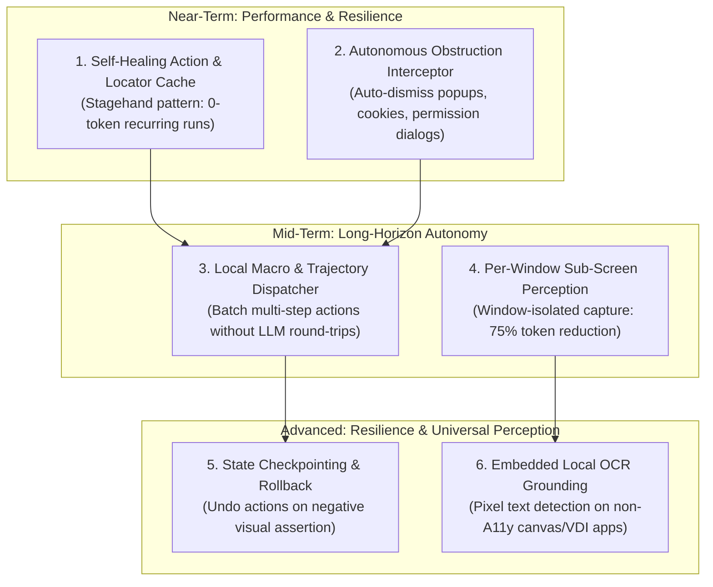

# Vision Control MCP Next-Generation Enhancement Roadmap

Based on empirical research with Gemini (Flash & Argon) and live desktop automation sessions, this roadmap outlines six next-generation capabilities to transform the Vision Control MCP server into an autonomous, resilient, enterprise-grade execution engine for complex engineering and research tasks.

---

## 🗺️ Architectural Roadmap Overview



---

## 1. Self-Healing Action & Locator Cache (`ActionCache`)
* **Problem**: In repetitive workflows (e.g., refreshing a dashboard, switching models, opening tabs), the AI orchestrator repeatedly spends 1,000–2,000 tokens per screenshot re-identifying the exact same UI elements.
* **Architecture**:
  * Records element signatures upon first successful interaction: accessible role, name, relative screen offset, and localized visual template.
  * On subsequent invocations, attempts instant cached interaction directly.
  * If post-action delta check confirms success, the action completes in **<80ms with 0 LLM tokens**.
  * If delta check fails (UI layout shifted), it marks the cache entry dirty and automatically triggers visual grounding to heal the locator.

---

## 2. Autonomous Obstruction Interceptor (`ObstructionHandler`)
* **Problem**: Unpredictable modal dialogs (Chrome notification permissions, cookie banners, system update prompts) frequently disrupt long-horizon tasks and cause agents to stall.
* **Architecture**:
  * An automated pre-action filter that detects common obstruction patterns (high-contrast modal overlays, backdrop blur, known dialog titles).
  * Automatically applies non-destructive dismissal strategies (`Escape` key, clicking "Block", "Dismiss", or "Close") and resumes the primary workflow without interrupting the planner.

---

## 3. Local Macro & Trajectory Dispatcher (`execute_trajectory`)
* **Problem**: For a 15-step sequence (e.g. open browser $\rightarrow$ focus address bar $\rightarrow$ type URL $\rightarrow$ wait $\rightarrow$ login $\rightarrow$ submit), standard MCP requires 15 distinct JSON-RPC round-trips to the LLM.
* **Architecture**:
  * The orchestrator emits a structured declarative trajectory:
    ```json
    [
      {"action": "focus_window", "title": "Chrome"},
      {"action": "click_and_type", "query": "Search", "text": "arxiv", "enter": true},
      {"action": "wait_for_ui_change", "timeout": 8.0}
    ]
    ```
  * The MCP server executes the batch locally at native speeds, validating deltas between each step.
  * It only returns to the LLM when the trajectory finishes or if a step encounters an unresolvable failure.

---

## 4. Per-Window Sub-Screen Perception (`capture_window`)
* **Problem**: Full-screen 4K captures (3024x1898) include vast areas of irrelevant desktop background, panel bars, and side windows, inflating tokens.
* **Architecture**:
  * Automatically crops the capture frame to the bounding box of the active or target window (`win.bbox`).
  * Cuts image pixel count and multimodal token weight by **60% to 80%**, while retaining 100% resolution for interactive elements.

---

## 5. State Checkpointing & Rollback (`StateManager`)
* **Problem**: Autonomous agents operating in complex environments can make navigational mistakes (closing the wrong document, triggering an error state).
* **Architecture**:
  * Captures light state checkpoints before executing destructive or uncertain actions.
  * Provides an automated rollback primitive (`undo_last_action`, `revert_to_checkpoint`) using OS-level shortcuts (`Ctrl+Z`, `Alt+Left`, window restore) when visual assertions fail.

---

## 6. Embedded Local OCR Grounding (`OCRTextProvider`)
* **Problem**: When automating canvas apps, WebGL terminals, legacy CAD/EDA tools, or remote VNC sessions, AT-SPI2 has zero nodes.
* **Architecture**:
  * Integrates a fast, local neural OCR engine (e.g., Tesseract/PaddleOCR or quantized lightweight vision encoder).
  * Translates pixel regions into searchable text blocks, enabling `find_element(query="...")` even on pure pixel displays.
