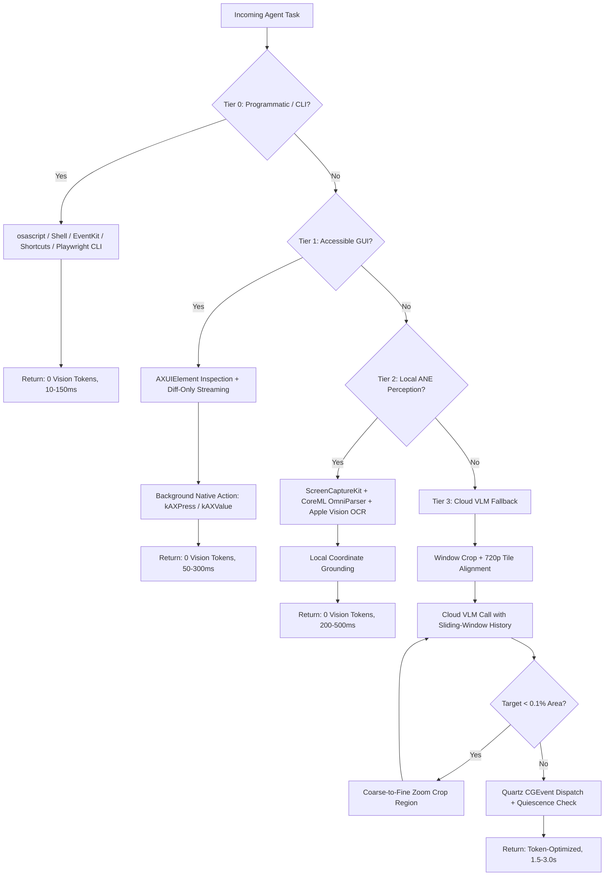

# Architecting High-Efficiency Computer-Use Agents: Control Paradigms, Token Economics, and macOS Implementation

> **Source:** Extracted from deep-research session on Gemini Desktop App (*macOS AI Orchestration and Automation*).
> **Objective:** Grounding the architectural evolution of `desktop-control` MCP for production macOS environments, eliminating quadratic context explosion, and achieving zero-token determinism.

---

## Executive Summary

Controlling computers effectively with AI agents while maximizing token efficiency requires replacing naive, full-resolution screenshot loops with a tiered, hybrid perception-and-execution architecture. In a conventional vision-first loop, transmitting unscaled full-screen captures and retaining visual history across a 25-step workflow consumes between **375,000 and 1,005,825 input tokens per task**, driving single-task API costs up to **$25.50–$72.40** on long-horizon frontier benchmarks while introducing 2 to 5 seconds of per-step latency and systematic coordinate drift on high-DPI displays.

By restructuring the agent harness to prioritize zero-vision CLI and scripting commands (`@playwright/cli`, `osascript`, `Shortcuts`), diff-only pruned OS Accessibility trees (`AXUIElement`), local hardware-accelerated perception (`ScreenCaptureKit` paired with Apple Vision OCR and CoreML OmniParser v2), and sliding-window prompt caching, engineering teams can cut cumulative token consumption by **78% to 98% (down to 16,160–220,674 tokens per 25-step task)** and reduce action latency to **50–300 milliseconds**.

Achieving these efficiency gains without sacrificing task completion requires balancing structural determinism against visual generality:
1. **Structural Brittleness:** Purely structural agents relying on web DOM or OS accessibility trees eliminate vision token fees and Retina scaling bugs, but fail on canvas-rendered interfaces (Figma, web games), uninstrumented desktop shells (Spotify on macOS exposing only 3 window buttons), or malformed web markup (web accessibility regressed in 2026 for the first time in 6 years).
2. **Visual Target Degradation:** Conversely, aggressive screenshot downscaling saves 66%–85% of visual tokens but degrades small UI targets (shrinking a 16px checkbox on a 4K display to an illegible 5px blob at 720p) and collapses OCR accuracy when character height falls below the 15-to-20px stroke blur threshold.
3. **Harness Engineering vs. Model Scale:** On multi-hour workflows (OSWorld 2.0, median human time 1.6 hours), monolithic frontier models score just 20.6% binary completion (Claude Opus 4.8 at **$72.40/task**), whereas pairing an open-weight model (Qwen3.8-27B) with self-evolving tool interfaces (Agent S4) achieves 21.3% binary completion at **$1.10/task**—proving that harness engineering and interface optimization now outweigh raw model scale in both reliability and cost efficiency.

---

## 1. Current Approaches to Computer-Use Agents

Modern computer-use agents (CUAs) operate across three primary control paradigms: pixel-based vision loops, structured accessibility-tree/DOM parsers, and programmatic API/CLI/MCP execution layers.

### Comparative Architectural Matrix

| Paradigm | Representative Systems & Models | Observation & Input | Action Dispatch Mechanism | Typical Input Tokens/Step (Unpruned vs. Optimized) | Latency / Step | Strengths | Failure Modes & Limitations |
| :--- | :--- | :--- | :--- | :--- | :--- | :--- | :--- |
| **Vision-First Universal GUI** | Anthropic Computer Use (`computer_toolset_20260801`), OpenAI CUA (`gpt-6.1-sol`, `gpt-6-astra`), Gemini Computer Use (`gemini-3.8-flash`, `gemini-4-argon`), UI-TARS | Full PNG/JPEG screenshot of desktop or viewport | Synthetic OS mouse clicks (`CGEvent`, `xdotool`, `SendInput`) & keyboard | 1,105–4,840 tokens (unscaled) $\rightarrow$ 516–1,200 tokens (cropped/downscaled) | 1.5–5.0 s (VLM round-trip) | Universal; works across legacy software, VMs, canvas, games, and remote desktops | High token cost; multi-step text editing failure; blind retries on unfamiliar UIs; Retina coordinate drift |
| **Structured DOM & AXTree** | Browser-Use, Stagehand v3/v4, `macos-use`, `mac-use`, Fazm, TypeSafe (`clicker`) | Compact Accessibility Tree (AXRole, AXTitle, AXPosition) or CDP AXTree | Direct AX action (`kAXPressAction`, `kAXValueAttribute`), CDP DOM dispatch | 1,000–4,300 tokens (initial tree) $\rightarrow$ 100–400 tokens (diff-only / interactive-only) | 50–300 ms (local IPC <50ms) | Scale-independent; zero vision tokens; background dispatch without stealing focus or moving cursor | Fails on canvas/WebGL, custom Qt/Tk controls without accessibility, empty AX shells (Spotify) |
| **CLI, Scripts & MCP** | `@playwright/cli`, `osascript`, Apple Shortcuts, Cueward, native MCP | Shell outputs, exit codes, disk snapshots (`.playwright-cli/*.yaml`), EventKit | Shell commands (`bash`, `zsh`), AppleScript/JXA, direct SQLite reads | ~150–500 tokens (disk-backed YAML/PNG paths) | 10–150 ms | Deterministic; 0 visual tokens; composes with shell pipes (`&&`); generates repeatable test scripts | Requires shell/terminal access; brittle across CLI breaking changes; lacks UI feedback on visual apps |

### Provider API Coordinate Systems & Specifications
- **Anthropic Claude (`computer_toolset_20260801`):** Operates strictly in the pixel space of the provided image. Deprecated legacy parameters (`display_width_px`, `display_height_px`). Claude 4.6 enforces a 1,568px long-edge limit (~1.15 MP, ~1,568 tokens). Claude Opus 4.7+ supports high-resolution up to 2,576px (~3.75 MP, ~4,840 tokens) with 1:1 coordinate mapping.
- **OpenAI CUA (`gpt-6.1-sol`, `gpt-6-astra`):** Operates in CSS pixels across the visible viewport. Emits batched `actions[]` sequences (`click`, `move`, `scroll`, `keypress`, `type`, `wait`, `click_at`, `hover_at`, `set_checked`). Captures a single final screenshot post-batch.
- **Google Gemini Computer Use (`gemini-3.8-flash`, `gemini-4-argon`):** Available via stateless `GenerateContent` and stateful Interactions API (`/v1beta/interactions` with `previous_interaction_id`). Predicts coordinates on a **normalized 1000×1000 integer grid (0 to 999)**. Decouples coordinate prediction from server-side image resizing.

---

## 2. Token Cost Drivers in Computer-Use Workflows

### Image Tokenization Mathematics Across Providers
1. **Anthropic Claude:** Slices images into $28 \times 28$ pixel patches.
   $$\text{Tokens}_{\text{Claude}} \approx \frac{W \times H}{750}$$
   Standard Tier: max long edge 1,568px ($\le 1.15\text{ MP}$, ~1,560 tokens). High-Res Tier (Opus 4.7+): max long edge 2,576px ($\le 3.75\text{ MP}$, ~4,840 tokens).
2. **OpenAI:**
   - *512px Tile Mode:* $\text{Tokens} = 85 + 170 \times \lceil W_{\text{scaled}} / 512 \rceil \times \lceil H_{\text{scaled}} / 512 \rceil$. All standard 16:9 widescreen screenshots from 720p to 4K cost exactly 1,105 tokens.
   - *32px Patch Mode (`gpt-4.1` family):* Patches of $32 \times 32$ pixels, capped at 1,536 patches. Multipliers apply: `gpt-4.1` (1.0x), `gpt-4.1-mini` (1.62x), `gpt-4.1-nano` (2.46x).
3. **Google Gemini:** Base tile $384 \times 384$ px (258 tokens). For larger images:
   $$\text{Tokens}_{\text{Gemini}} = \lceil W / 768 \rceil \times \lceil H / 768 \rceil \times 258$$
   - $1280 \times 720$: $2 \times 1 = 2\text{ tiles}$ (**516 tokens**).
   - $1920 \times 1080$: $3 \times 2 = 6\text{ tiles}$ (**1,548 tokens**).
   - $3840 \times 2160$: $5 \times 3 = 15\text{ tiles}$ (**3,870 tokens**).
   - Gemini 3/4 `media_resolution`: LOW (280 tokens), MEDIUM (560 tokens), HIGH (1,120 tokens), ULTRA_HIGH (2,240 tokens).

### Quadratic Trajectory Accumulation
In an unpruned multi-turn agent loop, every step $t$ re-transmits the system prompt, tool definitions, and all prior screenshots and action thoughts:
$$\text{Total Input Tokens}(T) = \sum_{t=1}^T \left( S_{\text{sys}} + t \cdot I_{\text{img}} + t \cdot I_{\text{text}} \right) \approx S_{\text{sys}} \cdot T + \frac{T(T+1)}{2}(I_{\text{img}} + I_{\text{text}})$$
For a 25-step task with 1080p images ($I_{\text{img}} = 2,691$, $I_{\text{text}} = 250$, $S_{\text{sys}} = 2,000$):
- Step 1: 4,941 tokens.
- Step 25: 75,525 tokens.
- **Cumulative Total: 1,005,825 input tokens.**

### Spatiotemporal Redundancy
Patch-level analysis across eight major CUA benchmarks (ReVision study) reveals that **45.4% of visual patches are completely identical across consecutive steps**:
- OSWorld: 56.2% redundancy across 16.9 average steps.
- WindowsAgentArena: 52.8% redundancy across 11.7 steps.
- VisualWebArena: 49.6% redundancy across 6.8 steps.
- Flat background non-edge regions occupy **51.9%** of each desktop screenshot.

---

## 3. Concrete Token-Saving Techniques

### 1. Tile-Aligned Pre-Downscaling
- Pre-downscale 16:9 desktop captures to **1280×720 (720p)**.
- On Gemini, $1280 \times 720$ snaps directly to $2 \times 1 = 2\text{ tiles}$ (**516 tokens**), saving 66.7% compared to 1080p ($3 \times 2 = 6\text{ tiles}$, 1,548 tokens).
- Avoids server-side downscaling that distorts predicted mouse coordinates.

### 2. Differential Rendering & Coarse-to-Fine Zoom
- Clamp captures strictly to the active frontmost window bounding box plus an 8-point margin (saving 60%–80% of tokens).
- Maintain a grid of $256 \times 256$ tiles downscaled by 1/8: unchanged tiles reuse cached OCR strings, while changed tiles are clustered into bounding boxes.
- Implement cascaded search: base capture at 720p, invoking coarse-to-fine zoom (`region: [x1, y1, x2, y2]`) only when targeting small controls (<0.1% screen area).

### 3. Algorithmic Visual Token Pruning
- **GUIPruner:** Temporal-Adaptive Resolution (TAR) downscales historical frames while Stratified Structure-aware Pruning (SSP) retains interactive foreground ($S_{\text{fg}}$), background anchors ($S_{\text{bg}}$), and a uniform grid ($S_{\text{uni}}$), delivering a 3.4x FLOPs reduction.
- **ReVision / RTS:** Drops unchanged patches across consecutive frames, cutting visual tokens by 46%–48% while boosting task success (+3%).
- **AQuaUI:** Conditional quadtree refinement cuts visual tokens by 29.5% with 99.06% retention of task performance.

### 4. Local Set-of-Marks (SoM) Grounding on Apple Neural Engine (ANE)
- Running local CoreML OmniParser v2 (`icon_detect_v3`) and Apple Vision OCR (`VNRecognizeTextRequest` at `.accurate`) on the ANE resolves clickable elements locally at **0 cloud tokens** and <300ms latency.
- Pass discrete IDs (`[1]`, `[2]`, `[JK]`) rather than requiring continuous coordinate regression from cloud models.

### 5. Accessibility Tree Pruning & Diff-Only Streaming
- Strip non-essential visual tags (`[cursor=pointer]`, `/url:`).
- Assign `ref=eX` IDs strictly to interactive nodes.
- Flatten nested table structures into single-line rows.
- Send the full AX tree on Step 1; emit **diff-only payloads (added, removed, modified)** on subsequent turns.
- Cap tree walks at 4,000 nodes or 0.6 seconds; drop off-screen subtrees and elements smaller than 4 points.

### 6. Action Selector Caching & Self-Healing
- Hash natural-language intent, normalized URL/window title, and local AX structure.
- Replay cached selectors directly with 0 LLM calls (80% speedup on repetitive flows).
- Enable `selfHeal`: re-invoke local grounding or VLM only if the cached selector fails to resolve.

### 7. Sliding-Window Image Eviction & Context Compaction
- Sliding-window tool clearing (`clear_tool_uses_20250919`): retain only the last 3 screenshots, replacing older frames with text placeholders.
- Evict thinking blocks (`clear_thinking_20251015`) to preserve prefix cache validity.
- Context Compaction: summarize history when token thresholds are exceeded, preserving an **8-part invariant contract**:
  1. USER INSTRUCTIONS (verbatim criteria and mandatory constraints).
  2. TASK TEMPLATE (repeatable workflow loops).
  3. CONSTRAINTS AND RULES (discovered edge cases).
  4. ACTIONS TAKEN (chronological trace).
  5. ERRORS AND FIXES (failed attempts to prevent infinite retry loops).
  6. PROGRESS TRACKING (completed vs. remaining).
  7. CURRENT STATE (active app, window, state).
  8. NEXT STEP (explicit resumption entry point).

### 8. Prompt Cache Prefix Invariants
- Prompt prefix structure: `[Static System Prompt] -> [Sorted Tool Definitions] -> [Static Instructions] -> [Turn History]`.
- Place 4 cache breakpoints strategically (tool entry point + 3 most recent turns).
- Never mutate the tool definitions array mid-session; use explicit system message blocks for dynamic tool activation.

---

## 4. Reliability vs. Efficiency Trade-Offs

1. **Retina 2x Scaling Mismatch:**
   macOS Retina displays capture physical pixels at $2\times$ scale (e.g. $3024 \times 1964$ physical vs. $1512 \times 982$ logical points). If unscaled images are sent to an API predicting pixel coordinates, clicks land with a $2\times$ offset unless scaled by $1 / \text{backingScaleFactor}$.
2. **Silent Server-Side API Downscaling:**
   APIs that downscale images exceeding 1,568px long-edge introduce coordinate drift up to 37% unless the client performs explicit pre-downscaling and maps coordinates back via live scale factors.
3. **Small-Target Grounding Collapse:**
   Downscaling a 4K capture to 720p reduces a 16px checkbox to 5px and 12pt text to 3–4px, causing severe OCR hallucinations. Mitigated by coarse-to-fine zoom cropping.
4. **State Verification & Post-Conditions:**
   Never assume an action succeeded. Verify via:
   - Event-driven visual quiescence and pixel delta ratios.
   - On-device Apple Vision OCR assertions (`assert_screen_text`).
   - AX element state checks (`AXFocused`, `AXValue`).
5. **Batch Action Fail-Fast Protocol:**
   In batched actions or trajectories, if an intermediate step fails, immediately halt downstream actions, mark `is_error: true`, and return failure diagnostics to prevent catastrophic cascading errors.

---

## 5. Benchmarks & Empirical Data

- **OSWorld / OSWorld-Verified (369 tasks):**
  Human baseline: 72.36%. Top models reach 83%–86% at 100 steps (Qwen3.8 Max 86.1%, Claude Opus 4.8 83.4%, Gemini 3.6 Flash 83.0%). However, WES+ step efficiency penalty drops Agent S2 from 41.4% to 28.2%.
- **OSWorld 2.0 (June 2026, 108 long-horizon tasks, median human time 1.6 hrs):**
  Monolithic frontier models hit severe cost walls:
  - Claude Opus 4.8: 20.6% binary completion at **$72.40 / task**.
  - GPT-5.5: 13.0% at **$25.50 / task**.
  - Qwen3.8-27B + Agent S4: **21.3% binary completion at $1.10 / task** ($1.27 with scratch VM).
  - Holo4-27B: 61.7% partial completion at **$1.22 / task**.
- **ScreenSpot-Pro (1,581 high-res tasks, targets avg 0.07% screen area):**
  Coarse-to-fine cascaded search lifts grounding accuracy by +13% to +29% (Claude Opus jumps from 57.4% to 82.3%; OS-Atlas-7B jumps from 18.9% to 48.1%).
- **WebArena / Verified Hard (137 tasks):**
  Top systems: WebTactix (74.3%), OpAgent (71.6%), ColorBrowserAgent (71.2%), Claude Code + GBOX (68.0%). On Verified Hard, OpenAI Operator drops to 31.2%–41.0%.

---

## 6. Recommended macOS Architecture & Implementation Checklist

### Four-Tier Escalation Blueprint
1. **Tier 0 (Zero-Token Programmatic Execution):**
   Execute via CLI, AppleScript/JXA (`osascript`), SQLite, EventKit, or Apple Shortcuts. 10–150ms latency, zero tokens.
2. **Tier 1 (Pruned AXUIElement Tree & Diff-Only Streaming):**
   Query native macOS Accessibility. Use background actions (`kAXPressAction`, direct `kAXValueAttribute` typing) without stealing focus or moving the physical mouse. Stream diffs on turns $N > 1$.
3. **Tier 2 (On-Device Neural Perception via ANE):**
   Capture via `ScreenCaptureKit`, run CoreML OmniParser v2 and Apple Vision OCR locally. Ground buttons and icons with zero external API calls.
4. **Tier 3 (Cloud VLM Fallback with Tile Alignment & Coarse-to-Fine Zoom):**
   Crop to active window, pre-downscale to 720p ($2 \times 1$ Gemini tiles = 516 tokens), apply sliding-window tool clearing, and invoke zoom crops only for micro-targets.

---

## 7. macOS Implementation Checklist for `desktop-control`

- [x] **Retina Coordinate Normalization:** Logical point scaling in `MacHAL` (`capture_screen`, `mouse_click`, `CGEventGetLocation`).
- [x] **Failsafe Watchdog:** Immediate termination when cursor hits `(0, 0)`.
- [x] **Event-Driven Quiescence:** Visual delta verification post-action (`ActionVerificationResult`).
- [ ] **Batch Action Fail-Fast Protocol:** In `TrajectoryEngine`, enforce `is_error: true` and abort downstream steps on failure.
- [ ] **Local OCR Assertions in Trajectories:** Implement `assert_screen_text` and `assert_screen_text_not_present` using Apple Vision OCR.
- [ ] **Diff-Only Accessibility Streaming:** Add `diff_only: bool = False` to `get_accessibility_tree` to emit element diffs.
- [ ] **Coarse-to-Fine Zoom Crop:** Support targeted crop regions in `take_screenshot` for small-target visual grounding.

