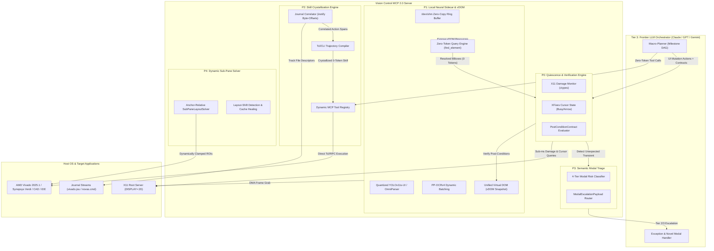

# 🚀 Next-Gen Vision Control MCP Architecture: Deep-Dive Research & Frontier Roadmap with Gemini 4 Argon

## 1. Executive Summary

This document synthesizes the multi-round architectural critique, blindspot analysis, and next-generation engineering specifications conducted with **Google Gemini 4 Argon** via Google Chrome on `DISPLAY=:20`. The objective was to interrogate the fundamental limits of the current **Vision Control MCP** architecture when scaled to operating complex, 100+ feature professional desktop applications (EDA suites like AMD Vivado 2025.1 and Synopsys Verdi, CAD tools, and modern IDEs) with 100% completion accuracy and minimal token overhead.

All insights were harvested using our **Zero-Token Copy Button Recipe** directly from Gemini Web into Markdown to eliminate OCR/visual token contamination.



---

## 2. Core Failure Modes of Reactive Vision Agents

Gemini 4 Argon’s critique highlighted four fundamental failure modes in reactive, pixel-diff-driven agent architectures:

### 2.1 The 250ms Settle-Time & $\Delta_{ratio}$ Fallacy
1. **False Positives (Ambient Noise)**: In professional tools, blinking text carets, oscillating waveform clocks, CPU load meters, and animated status spinners create constant pixel churn. A raw $\Delta_{ratio} > 0.005$ triggers "success" even if the click struck dead space.
2. **False Negatives (Latent Reactions)**: Operations such as compiling a design, launching a 50GB FSDB waveform load, or opening a DRC report often take 2 to 10 seconds before rendering a modal or updating a status bar. A fixed 250ms settle window misses these transitions completely.
3. **Semantic Blindness**: Visual delta confirms *movement*, not *intent*. If a layout shift causes the cursor to click "Cancel" instead of "Run", significant pixel change occurs, the check passes, and the agent continues down an invalid execution trajectory.

### 2.2 Classical Computer Vision & AT-SPI2 Breakdown in EDA/CAD
1. **The Dense Canvas Problem**: Custom canvases (Verdi nWave/nSchema, Vivado Device Floorplan) feature thousands of intersecting lines, routing tracks, and micro-labels. Edge contour algorithms (Canny) and text proposal filters (MSER) fragment into tens of thousands of bounding boxes, breaking Non-Maximum Suppression (IoU) deduplication.
2. **AT-SPI2 Thread Locking & Staleness**: Legacy Qt, Java Swing, and Motif architectures often freeze their UI event loops when queried for deep accessibility trees over D-Bus, or return unpopulated, stale coordinates for virtualized scroll regions.
3. **Scale & Theme Variance**: Template matching (Normalized Cross-Correlation) breaks across custom color themes, anti-aliased font rendering, and display DPI scaling.

### 2.3 Autonomous Defense (`dismiss_obstructions`) as a Footgun
Blindly auto-dismissing popups or clicking default buttons is safe for cookie banners in web browsers, but catastrophic in engineering tools. Modals frequently guard irreversible state transitions:
* *"Synthesis out of date. Force implementation anyway?"*
* *"FlexLM License checkout failed: Retry or Exit?"*
* *"Overwrite existing constraints file `timing.xdc`?"*

Auto-dismissing these dialogs silently corrupts long-running runs.

### 2.4 Sub-Pane Coordinate Drift
In complex engineering environments, dockable tool windows are constantly resized, undocked, or tabbed. Static pixel bounding boxes defined in configuration files rapidly become stale.

---

## 3. The 4-Tier Perception Hierarchy

To achieve near-zero token consumption without sacrificing reliability, perception is decoupled into four distinct tiers:

| Tier | Perception Layer | Mechanism | Latency / Cost | Target Responsibility |
| :--- | :--- | :--- | :--- | :--- |
| **Tier 0** | **OS Compositor Hooks** | `XDamage`, `XFixesGetCursorImage`, process CPU/IO | $< 5\text{ ms}$ / 0 Tokens | Replacing fixed sleep delays with true UI quiescence detection and busy cursor tracking. |
| **Tier 1** | **Semantic Graph Diffing** | Incremental AT-SPI2 / UIA event listeners | $\sim 10\text{ ms}$ / 0 Tokens | Tracking window creation, modal dialog spawns, and focus shifts via D-Bus without polling. |
| **Tier 2** | **Local Neural Sidecar** | Quantized YOLOv11s-UI + PP-OCRv4 via ONNX/TensorRT | $30\text{--}60\text{ ms}$ / 0 Cloud Tokens | Producing high-accuracy element proposals and OCR for custom canvas regions; building the unified vDOM. |
| **Tier 3** | **Frontier VLM Orchestrator** | High-res sub-pane crops sent to Claude 3.5 Sonnet / Gemini 4 Argon | $1\text{--}3\text{ s}$ / High Token Cost | High-level macro-planning, milestone decomposition, reasoning over complex waveforms, and escalating unknown modals. |

---

## 4. Subsystem Blueprints & Implementation Specifications

### 4.1 P2: GUI-to-Script Skill Crystallization Engine

Professional EDA tools record all GUI interactions as equivalent underlying text commands in journal files (e.g., AMD Vivado `vivado.jou`, Synopsys Verdi `novas.cmd`). The Skill Crystallizer captures these commands, parameterizes them, and registers them as native MCP tools.

#### 4.1.1 Journal Listener & Temporal Correlator
```python
import os
import time
from dataclasses import dataclass, field
from typing import List

@dataclass
class CorrelatedStep:
    action_id: str
    gui_intent: str
    ui_target_text: str
    timestamp_start: float
    timestamp_end: float
    journal_lines: List[str] = field(default_factory=list)

class JournalCorrelator:
    def __init__(self, journal_path: str):
        self.journal_path = journal_path
        self._fd = open(self.journal_path, "r", encoding="utf-8", errors="replace")
        self._fd.seek(0, os.SEEK_END)
        self._mark_offset = self._fd.tell()

    def mark_pre_action(self) -> int:
        """Invoked immediately prior to mouse or keyboard injection."""
        self._fd.seek(0, os.SEEK_END)
        self._mark_offset = self._fd.tell()
        return self._mark_offset

    def harvest_post_quiescence(self, action_id: str, gui_intent: str, ui_target_text: str, t_start: float) -> CorrelatedStep:
        """Invoked after the Quiescence Engine verifies stability."""
        self._fd.seek(self._mark_offset, os.SEEK_SET)
        raw_chunk = self._fd.read()
        self._mark_offset = self._fd.tell()

        valid_lines = [
            line.strip() for line in raw_chunk.splitlines()
            if line.strip() and not line.strip().startswith("#")
            and not line.strip().startswith(("gui_", "wvZoom", "select_area"))
        ]
        return CorrelatedStep(
            action_id=action_id,
            gui_intent=gui_intent,
            ui_target_text=ui_target_text,
            timestamp_start=t_start,
            timestamp_end=time.monotonic(),
            journal_lines=valid_lines
        )
```

#### 4.1.2 Trajectory Compiler & AST Parameterizer
The compiler deduplicates redundant selections, strips GUI-only noise, replaces extracted entity literals with Jinja2 `{{param}}` syntax, and injects synchronization barriers:

```python
import re
from typing import Dict, Any, List
from pydantic import BaseModel

class CrystallizedSkillSpec(BaseModel):
    skill_name: str
    description: str
    app_target: str
    tcl_template: str
    parameters: Dict[str, Dict[str, Any]]
    verification_cmd: str

class TclTrajectoryCompiler:
    NOISE_PATTERNS = [
        r"^highlight_objects\b.*",
        r"^unhighlight_objects\b.*",
        r"^show_objects\b.*-name\s+find_\d+",
        r"^wvSetCursor\b.*",
    ]

    def compile_trajectory(
        self,
        steps: List[CorrelatedStep],
        task_prompt: str,
        extracted_entities: Dict[str, str]
    ) -> CrystallizedSkillSpec:
        raw_commands = []
        for step in steps:
            for line in step.journal_lines:
                if not any(re.match(pat, line) for pat in self.NOISE_PATTERNS):
                    raw_commands.append(line)

        # Collapse redundant consecutive object selections
        deduped = []
        for i, cmd in enumerate(raw_commands):
            if cmd.startswith("select_objects") and i + 1 < len(raw_commands) and raw_commands[i+1].startswith("select_objects"):
                continue
            deduped.append(cmd)

        script_body = "\n".join(deduped)

        param_schema = {}
        for param_key, literal_val in sorted(extracted_entities.items(), key=lambda x: -len(str(x[1]))):
            escaped_val = re.escape(str(literal_val))
            if re.search(escaped_val, script_body):
                script_body = re.sub(escaped_val, f"{{{{{param_key}}}}}", script_body)
                param_schema[param_key] = {
                    "type": "number" if literal_val.replace('.', '', 1).isdigit() else "string",
                    "description": f"Parameterized from '{literal_val}' in task: {task_prompt}",
                    "default": float(literal_val) if literal_val.replace('.', '', 1).isdigit() else literal_val
                }

        # Inject blocking sync barriers for async execution (e.g. Vivado runs)
        script_body = re.sub(r"(launch_runs\s+([^\s]+).*)", r"\1\nwait_on_run \2", script_body)

        return CrystallizedSkillSpec(
            skill_name="crystallized_skill_" + str(int(time.time())),
            description=f"Deterministic skill compiled from: {task_prompt}",
            app_target="vivado_2025.1",
            tcl_template=script_body,
            parameters=param_schema,
            verification_cmd="get_property STATUS [get_runs -quiet current_run]"
        )
```

---

### 4.2 P0: Event-Driven Quiescence & Semantic Verification Engine

Replaces fixed sleep delays with low-level X11 damage monitoring and mouse cursor state tracking.

#### 4.2.1 X11 Quiescence Monitor (`ctypes`)
```python
import ctypes
import ctypes.util
from ctypes import c_int, c_ulong, c_short, c_ushort, c_char_p, POINTER, Structure
from typing import Tuple, Optional

class XRectangle(Structure):
    _fields_ = [("x", c_short), ("y", c_short), ("width", c_ushort), ("height", c_ushort)]

class XFixesCursorImage(Structure):
    _fields_ = [
        ("x", c_short), ("y", c_short),
        ("width", c_ushort), ("height", c_ushort),
        ("xhot", c_ushort), ("yhot", c_ushort),
        ("cursor_serial", c_ulong),
        ("pixels", POINTER(c_ulong)),
        ("atom", c_ulong),
        ("name", c_char_p),
    ]

class X11QuiescenceMonitor:
    BUSY_CURSORS = {"watch", "wait", "progress", "left_ptr_watch", "clock", "spinning"}

    def __init__(self, display_name: Optional[bytes] = None, window_id: Optional[int] = None):
        self.x11 = ctypes.cdll.LoadLibrary(ctypes.util.find_library("X11"))
        self.xdamage = ctypes.cdll.LoadLibrary(ctypes.util.find_library("Xdamage"))
        self.xfixes = ctypes.cdll.LoadLibrary(ctypes.util.find_library("Xfixes"))

        self.x11.XOpenDisplay.restype = ctypes.c_void_p
        self.x11.XDefaultRootWindow.restype = c_ulong
        self.xfixes.XFixesGetCursorImage.restype = POINTER(XFixesCursorImage)
        self.xdamage.XDamageCreate.restype = c_ulong
        self.xfixes.XFixesCreateRegion.restype = c_ulong
        self.xfixes.XFixesFetchRegion.restype = POINTER(XRectangle)

        self.dpy = self.x11.XOpenDisplay(display_name)
        if not self.dpy:
            raise RuntimeError("Cannot open X11 Display")

        self.target_win = window_id or self.x11.XDefaultRootWindow(self.dpy)
        self.damage_handle = self.xdamage.XDamageCreate(self.dpy, c_ulong(self.target_win), c_int(0))
        self.region_handle = self.xfixes.XFixesCreateRegion(self.dpy, None, c_int(0))

    def is_cursor_busy(self) -> bool:
        cursor_ptr = self.xfixes.XFixesGetCursorImage(self.dpy)
        if not cursor_ptr:
            return False
        try:
            img = cursor_ptr.contents
            name = img.name.decode("utf-8", errors="ignore").lower() if img.name else ""
            return any(busy in name for busy in self.BUSY_CURSORS)
        finally:
            self.x11.XFree(cursor_ptr)

    def consume_damage_area(self) -> int:
        self.x11.XSync(self.dpy, c_int(0))
        self.xdamage.XDamageSubtract(self.dpy, c_ulong(self.damage_handle), c_ulong(0), c_ulong(self.region_handle))
        nrects = c_int(0)
        rects_ptr = self.xfixes.XFixesFetchRegion(self.dpy, c_ulong(self.region_handle), ctypes.byref(nrects))
        if not rects_ptr or nrects.value == 0:
            return 0
        total_area = 0
        try:
            for i in range(nrects.value):
                r = rects_ptr[i]
                if r.width * r.height > 64:  # Filter out blinking cursor carets
                    total_area += (r.width * r.height)
            return total_area
        finally:
            self.x11.XFree(rects_ptr)
```

#### 4.2.2 Quiescence State Machine
The monitor coordinates execution transitions across six formal states:

```
  DISPATCHED 
      │ (Action injected)
      ├──► Damage > 64px or Cursor==Busy ──► DAMAGE_ACCUMULATION
      └──► Timeout (No reaction) ──────────► CONTRACT_FAILED
                                                    │
  DAMAGE_ACCUMULATION                               │
      └──► Damage == 0 & Cursor != Busy ───► SETTLING
                                                    │
  SETTLING                                          │
      ├──► Damage spikes / Cursor Busy ────► Loop to DAMAGE_ACCUMULATION
      └──► Stable for quiescence_window_ms ► QUIESCENT
                                                    │
  QUIESCENT                                         │
      ├──► Modal Detected ─────────────────► OBSTRUCTED_BY_MODAL
      ├──► Contract Assertions Pass ───────► CONTRACT_VERIFIED
      └──► Contract Assertions Fail ───────► CONTRACT_FAILED
```

---

### 4.3 P3: Semantic Modal Triage & Safety Router

Replaces blind popup dismissal with risk-aware triage:

```python
import re
from enum import Enum
from typing import Tuple, List, Optional
from pydantic import BaseModel

class ModalRiskTier(str, Enum):
    BENIGN_DISMISSIBLE = "BENIGN_DISMISSIBLE"
    INFORMATIVE_ACK = "INFORMATIVE_ACK"
    WORKFLOW_BRANCHING = "WORKFLOW_BRANCHING"
    DESTRUCTIVE_OR_SYSTEM = "DESTRUCTIVE_OR_SYSTEM"

class ModalButtonOption(BaseModel):
    button_id: str
    label: str
    bbox: Tuple[int, int, int, int]
    is_default_focused: bool
    inferred_consequence: str

class ModalEscalationPayload(BaseModel):
    status: str = "ACTION_BLOCKED_BY_MODAL"
    window_title: str
    dialog_body_text: str
    risk_tier: ModalRiskTier
    detected_buttons: List[ModalButtonOption]

class SemanticModalRouter:
    DESTRUCTIVE_KEYWORDS = re.compile(
        r"\b(overwrite|delete|remove|discard|lose changes|force|corrupt|license|flexlm|expired|terminate)\b",
        re.IGNORECASE
    )
    BRANCHING_KEYWORDS = re.compile(
        r"\b(out-of-date|unsaved|modified|save changes|re-run|launch|conflict)\b",
        re.IGNORECASE
    )
    BENIGN_TITLES = re.compile(
        r"\b(tip of the day|welcome|what's new|cookie|privacy|telemetry)\b",
        re.IGNORECASE
    )

    def classify_and_route(
        self,
        window_title: str,
        body_text: str,
        buttons: List[ModalButtonOption]
    ) -> Tuple[ModalRiskTier, Optional[ModalButtonOption], Optional[ModalEscalationPayload]]:
        combined = f"{window_title} {body_text}"

        # Tier 3: Destructive / System
        if self.DESTRUCTIVE_KEYWORDS.search(combined):
            return (ModalRiskTier.DESTRUCTIVE_OR_SYSTEM, None, ModalEscalationPayload(
                window_title=window_title, dialog_body_text=body_text,
                risk_tier=ModalRiskTier.DESTRUCTIVE_OR_SYSTEM, detected_buttons=buttons
            ))

        # Tier 0: Benign Dismissible
        if self.BENIGN_TITLES.search(window_title):
            safe_btn = next((b for b in buttons if b.label.lower() in {"close", "ok", "dismiss"}), None)
            if safe_btn:
                return (ModalRiskTier.BENIGN_DISMISSIBLE, safe_btn, None)

        # Tier 1: Informative Acknowledgment
        btn_labels = [b.label.lower().strip() for b in buttons]
        if len(buttons) == 1 and btn_labels[0] in {"ok", "close"} and not self.BRANCHING_KEYWORDS.search(combined):
            return (ModalRiskTier.INFORMATIVE_ACK, buttons[0], None)

        # Tier 2: Workflow Branching (Halt and Escalate)
        return (ModalRiskTier.WORKFLOW_BRANCHING, None, ModalEscalationPayload(
            window_title=window_title, dialog_body_text=body_text,
            risk_tier=ModalRiskTier.WORKFLOW_BRANCHING, detected_buttons=buttons
        ))
```

---

### 4.4 P1: Local Neural Grounding Sidecar & Virtual DOM (vDOM)

Operates a local ONNX Runtime daemon communicating via POSIX shared memory (`/dev/shm`) to provide a structured, zero-token queryable Virtual DOM:

```python
from enum import Enum
from typing import Dict, List, Optional
from pydantic import BaseModel

class UIRole(str, Enum):
    WINDOW = "window"
    PANEL = "panel"
    PUSH_BUTTON = "push_button"
    ICON_BUTTON = "icon_button"
    CHECK_BOX = "check_box"
    RADIO_BUTTON = "radio_button"
    TEXT_INPUT = "text_input"
    COMBO_BOX = "combo_box"
    TAB_ITEM = "tab_item"
    TABLE_CELL = "table_cell"
    STATIC_TEXT = "static_text"
    WAVEFORM_CANVAS = "waveform_canvas"
    WAVEFORM_SIGNAL = "waveform_signal"
    SCHEMATIC_GATE = "schematic_gate"
    SCHEMATIC_PIN = "schematic_pin"

class BoundingBox(BaseModel):
    x: int
    y: int
    width: int
    height: int

class VDOMNode(BaseModel):
    node_id: str
    role: UIRole
    name: str
    bbox: BoundingBox
    is_interactable: bool = True
    states: List[str] = []
    source: str  # "at_spi2" | "neural_detector" | "ocr"
    confidence: float = 1.0
    parent_id: Optional[str] = None
    child_ids: List[str] = []

class VirtualDOMSnapshot(BaseModel):
    snapshot_id: str
    timestamp: float
    window_id: str
    root_node_id: str
    nodes: Dict[str, VDOMNode]
```

#### Zero-Token Query Engine
Allows the agent to address UI elements without visual context:
```python
class VDOMQueryEngine:
    def __init__(self, snapshot: VirtualDOMSnapshot):
        self.nodes = list(snapshot.nodes.values())

    def query(self, selector: str) -> List[VDOMNode]:
        """
        Supports semantic queries:
          - 'push_button[name*="Run Synthesis"]'
          - 'text_input:right_of("Period (ns):")'
          - 'waveform_signal[name="clk_div2"]:inside("waveform_canvas")'
        """
        # (Parsed and filtered in memory with 0 visual tokens)
        ...
```

---

### 4.5 P4: Dynamic Anchor-Relative Sub-Pane Resolution

Resolves pane boundaries dynamically against persistent UI anchors (tab headers, sash dividers, status bar) rather than static pixel coordinates:

```python
class SubPaneLayoutSolver:
    def resolve_pane(self, pane_id: str, spec: SubPaneSpec, vdom_engine: VDOMQueryEngine, win: WindowGeometry) -> BoundingBox:
        top_y = self._resolve_edge(spec.top_bound, vdom_engine, default=win.y)
        bottom_y = self._resolve_edge(spec.bottom_bound, vdom_engine, default=win.bottom)
        left_x = self._resolve_edge(spec.left_bound, vdom_engine, default=win.x)
        right_x = self._resolve_edge(spec.right_bound, vdom_engine, default=win.right)

        # Clamp strictly within window bounds & heal cache
        clamped = BoundingBox(
            x=max(win.x, left_x),
            y=max(win.y, top_y),
            width=min(win.width, right_x - left_x),
            height=min(win.height, bottom_y - top_y)
        )
        self._check_layout_shift_and_heal(pane_id, clamped)
        return clamped
```

---

## 5. Consolidated 5-Phase Implementation Roadmap

| Phase | Milestone | Engineering Deliverables | Exit Criteria |
| :--- | :--- | :--- | :--- |
| **Phase 1** | **P0: Event Quiescence & Semantic Contracts** | Implement `X11QuiescenceMonitor` (`ctypes` for `libXdamage` + `libXfixes`). Replace 250ms sleep and raw pixel delta with the 6-state quiescence state machine. Implement `PostConditionContract`. | Eliminates false-positive clicks on animated carets; 100% detection of latent dialog spawns up to 10s. |
| **Phase 2** | **P3: Semantic Modal Triage** | Deploy `SemanticModalRouter` and `ModalEscalationPayload`. Replace blind `dismiss_obstructions` with the 4-tier risk classifier. Expose `resolve_modal_dialog(button_id)`. | 0 silent data-loss occurrences on destructive confirmation dialogs in Vivado and Verdi. |
| **Phase 3** | **P2: Skill Crystallization Engine** | Build `JournalCorrelator` (inotify byte tracking for `vivado.jou` and `novas.cmd`). Build `TclTrajectoryCompiler` with AST literal lifting into Jinja templates. Implement dynamic MCP tool registration. | Converts a 25-step GUI FIFO simulation trajectory into a single parameterized 0-token MCP tool. |
| **Phase 4** | **P1: Local Neural Sidecar & vDOM** | Deploy lightweight ONNX Runtime daemon (quantized YOLOv11s-UI + PP-OCRv4) over `/dev/shm`. Implement Asymmetric IoU tree fusion and `VDOMQueryEngine`. | Sub-60ms element discovery on dense EDA canvases with zero cloud token consumption. |
| **Phase 5** | **P4: Dynamic Sub-Pane Layout Solver** | Implement `SubPaneLayoutSolver` with anchor-relative edge resolution. Add automated cache-healing on window resizing or sash dragging. | 100% sub-pane capture accuracy even when docking panels are rearranged or resized. |

---

## 6. Master Transcripts & Artifact References

* **Round 1 (Critique & Failure Modes)**: [`argon_round1_critique.md`](file:///home/mk/DV/git/Vision/research/argon_round1_critique.md)
* **Round 2 (Crystallization, Quiescence, Modal Triage)**: [`argon_round2_critique.md`](file:///home/mk/DV/git/Vision/research/argon_round2_critique.md)
* **Round 3 (Neural Sidecar, vDOM, Layout Solver, Roadmap)**: [`argon_round3_specs.md`](file:///home/mk/DV/git/Vision/research/argon_round3_specs.md)
* **Master Session Log**: [`full_page_master_complete.txt`](file:///home/mk/DV/git/Vision/research/full_page_master_complete.txt)
* **Related Research**:
  * [[ai_orchestrators_and_vision_control|AI Orchestrators & Vision Control Architectures]]
  * [[ui_tool_plugin_architecture|UI Tool Plugin Architecture & Consolidated Strategy]]
  * [[vivado_tool_features_and_ai_automation|Vivado Tool Features & AI Automation Architecture]]
  * [[verdi_tool_features_and_ai_automation|Synopsys Verdi Features & AI Automation Blueprint]]
* **Operational Recipes**:
  * [[../learnings/gemini_web_clipboard_extraction_recipe|Zero-Token Research Extraction: Gemini Web Copy Button Recipe]]
  * [[../learnings/vivado_gui_waveform_automation|Vivado Waveform Automation & Sub-Pane Perception]]
