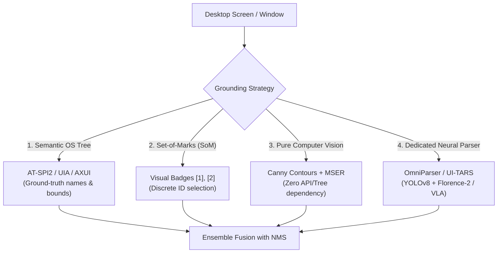

# Perception and Grounding Landscape for GUI Agents

## 1. The Grounding Challenge

Multimodal LLMs process images by slicing them into visual tokens (e.g., $16 \times 16$ or $28 \times 28$ pixel patches). Because of patch boundaries and coordinate normalization, native VLMs struggle to reliably predict exact pixel centroids for small UI elements (such as $16 \times 16$ icons or dropdown arrows).

Grounding techniques anchor high-level model intent to precise physical screen pixels.

---

## 2. The Four Primary Grounding Paradigms

### A. Semantic Grounding (OS Accessibility Bus)
* **Linux**: AT-SPI2 (`org.a11y.Bus` via D-Bus).
* **Windows**: UI Automation (UIA) and MSAA.
* **macOS**: Accessibility API (`AXUIElement`).
* **Pros**: 100% ground-truth element names, roles, and exact screen bounding boxes. Immune to theme/contrast changes. Enables **zero-token element lookup**.
* **Cons**: Broken or unimplemented in canvas-based web apps, remote VNC/Citrix desktops, and custom WebGL/game engines.

### B. Visual Prompting: Set-of-Marks (SoM)
* **Mechanism**: Overlays high-contrast, numbered badges onto interactive bounding boxes.
* **Pros**: Converts continuous $(x, y)$ coordinate regression into a simple discrete classification problem (`"Click badge [14]"`).
* **Cons**: Visual clutter on dense UIs (overlapping badges). Solved via Non-Maximum Suppression (NMS) and minimum area filtering.

### C. Pure Computer Vision & MSER Text Regions
* **Mechanism**: Multi-threshold Canny edge detection with morphological closing to identify button borders, combined with Maximally Stable Extremal Regions (MSER) for text blocks.
* **Pros**: Zero external dependencies. Operates purely on raw pixels.
* **Cons**: Lacks high-level semantic labels unless paired with OCR.

### D. Dedicated Neural UI Parsers
* **OmniParser v2 (Microsoft)**:
  * Uses fine-tuned **YOLOv8** to segment icons and interactable elements.
  * Uses **Florence-2** and local OCR to caption icons and extract button text.
  * Emits structured JSON bounding boxes and tagged images.
* **UI-TARS (ByteDance)**:
  * End-to-end Vision-Language-Action (VLA) model based on Qwen-VL.
  * Trained with reinforcement learning to output normalized absolute coordinates directly alongside System-2 reasoning traces.
