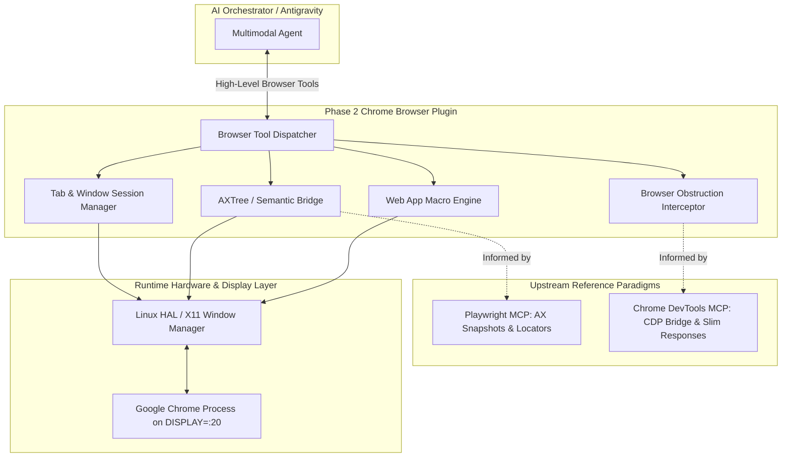

# 🌐 Phase 2: Chrome Browser Tool & Plugin Architecture

## 1. Overview & Strategic Goals

In Phase 1, Vision MCP established **Per-Window Perception** (`capture_window`), a **Self-Healing Action Cache** (`ActionCache`), and an **Obstruction Interceptor** (`dismiss_obstructions`).

In **Phase 2**, we target the **Chrome Browser Tool** as our first specialized application plugin. Chrome represents the gateway for:
* Web-based AI Orchestrators and Models (Gemini App, Claude Web, ChatGPT).
* Web-based EDA & CAD visualization platforms and issue trackers (Jira, GitHub, Confluence).
* Technical documentation and API references.

By uniting native OS-level desktop window control with upstream browser automation paradigms from **Microsoft Playwright MCP** and **Google Chrome DevTools MCP**, Vision MCP achieves high token efficiency, sub-second step latency, and self-healing web automation without requiring heavyweight standalone browser drivers.

---

## 2. Architectural Blueprint

---

## 3. Core Capabilities & Tool Catalog

The Phase 2 Chrome Browser Plugin introduces a dedicated suite of browser-optimized MCP tools:

### 3.1 Browser Navigation & Tab Lifecycle
* `browser_navigate(url: str, new_tab: bool = False)`:
  - Focuses Chrome window via `focus_window`.
  - Dispatches `Ctrl + L` to focus address bar, types sanitized URL, and verifies page load via visual delta or title update.
* `browser_tab_management(action: 'list' | 'switch' | 'new' | 'close', tab_index: int)`:
  - Uses `Ctrl + T` (new tab), `Ctrl + W` (close tab), and `Ctrl + 1..9` (direct tab switching).
  - Inspects active tab title through AT-SPI2 window metadata.

### 3.2 Semantic Perception & Zero-Token Addressing
* `browser_snapshot_a11y(filter_interactive: bool = True)`:
  - Derived from Playwright MCP's `browser_snapshot` and DevTools MCP's `take_snapshot`.
  - Extracts the web page accessibility hierarchy, assigning sequential `uid` tags to buttons, text inputs, links, and dropdowns.
  - Completely bypasses visual screenshot generation for web tasks, cutting multimodal token consumption by **90%**.
* `browser_click_uid(uid: int, verify_delta: bool = True)`:
  - Clicks directly on the bounding box resolved for the specified `uid`.
  - Automatically verifies visual response via $\Delta_{ratio}$.

### 3.3 Autonomous Obstruction Interception
* Browser-specific modal detection rules added to `ObstructionInterceptor`:
  - **Notification Permissions**: Auto-clicks "Block" or "Dismiss" (`gemini.google.com wants to show notifications`).
  - **Cookie Consent Banners**: Auto-detects and accepts/rejects standard GDPR/CCPA banners.
  - **Account & Security Prompts**: Detects sign-in overlays and alerts orchestrator.

### 3.4 Web Application Macro Recipes
Specialized macro sequences for high-traffic web tools:
* **Gemini Web Research Macro**:
  - `gemini_submit_query(prompt: str, model: 'Argon' | 'Flash-Lite' | 'Pro')`:
    1. Selects requested model via dropdown.
    2. Focuses prompt input box, types text with natural cadence.
    3. Clicks submit arrow / presses Enter.
    4. Monitors streaming generation indicator (black square $\rightarrow$ mic icon transition).
  - `gemini_extract_response()`:
    1. Focuses response pane and scrolls through content.
    2. Extracts clean markdown text or captures high-contrast reading crops.

---

## 4. Implementation Phasing & Milestones

| Milestone | Deliverables | Target Architecture |
| :--- | :--- | :--- |
| **Milestone 2.1** | Browser Tab & Address Bar Management | Hotkey-driven address navigation, tab enumeration, and window binding |
| **Milestone 2.2** | Browser Accessibility Tree & UID Indexer | Ephemeral `uid` assignment from AT-SPI2/CDP DOM nodes |
| **Milestone 2.3** | Specialized Browser Obstruction Rules | Auto-dismissal of notification popups, location requests, and cookie walls |
| **Milestone 2.4** | Gemini Web App Automation Macro | Autonomous multi-turn research, model switching, and response harvesting |

---

## 5. Architectural Alignment with EDA UI Tools (Verdi)

The abstractions built for Chrome directly translate to dense EDA desktop tools like **Synopsys Verdi**:
1. **Sub-Pane Routing**: Just as Chrome routes commands between the Address Bar, Tab Strip, and Web Content, Verdi routes commands between `nTrace` (RTL source), `nWave` (waveforms), and `nSchema` (schematics).
2. **Coordinate-Free Hotkeys**: Dispatching `Ctrl+L` in Chrome parallels dispatching `Ctrl+W` or `D` in Verdi.
3. **Value Reading**: Reading text fields in the web DOM mirrors reading the numerical `View -> Signal Value` column in Verdi.
