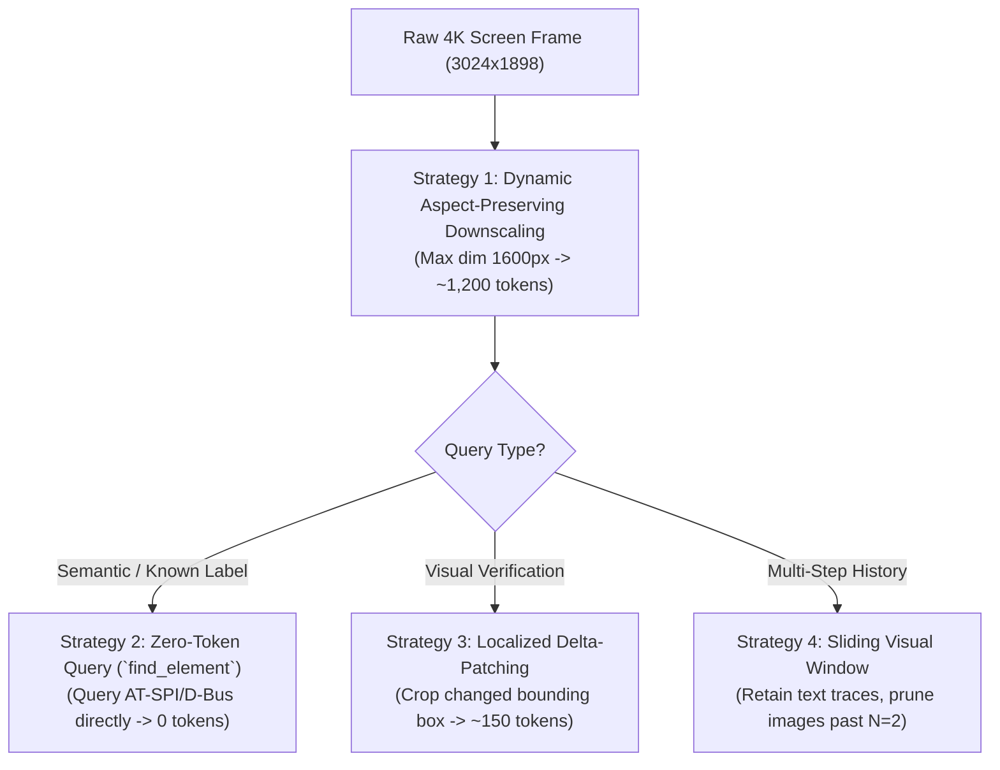

# Token Optimization and Cost Dynamics for Vision Control

## 1. The Context Explosion Problem

In multi-turn desktop agent workflows, vision tokens represent the single largest component of cost and latency.

* **Single Frame Token Weight**: A standard $1920 \times 1080$ frame consumed by models like Claude 3.5 Sonnet or Gemini 1.5/2.0 generates roughly **1,200 to 2,500 tokens**.
* **Cumulative Context Inflation**: In a 30-step task, retaining full visual frames results in $>60,000$ visual tokens in context. This causes:
  1. Exponential cost per subsequent step.
  2. Increased Time-To-First-Token (TTFT) latency (several seconds per step).
  3. Degradation in long-context attention quality ("Lost in the Middle").

---

## 2. Four Strategies for 80%+ Token Reduction

### Strategy 1: Dynamic Aspect-Preserving Downscaling
* Downscales the screenshot to a configurable maximum dimension (default: `1600px`).
* Inverts the scale factor mathematically when dispatching mouse clicks so physical accuracy is maintained regardless of downscaling.

### Strategy 2: Zero-Token Element Discovery
* Instead of capturing an entire screenshot to see where a button is, query the semantic accessibility tree or local cached registry using `find_element(query="Submit")`.
* Returns exact physical $(x, y)$ coordinates without sending any image tokens to the multimodal LLM context.

### Strategy 3: Localized Delta-Patching
* After executing an action, rather than capturing and transmitting the entire desktop screen again, compute the visual diff between pre- and post-action frames.
* Crop only the bounding box where changes occurred with padding (e.g. 24px) and return that compact patch.

### Strategy 4: Sliding Visual Windowing
* Multi-step agents must maintain conversational memory, but do **not** need to maintain visual frame buffers from 15 steps ago.
* Retain the full text reasoning chain, but prune all historical screenshot images except the most recent $N$ frames ($N=1$ to $3$).
