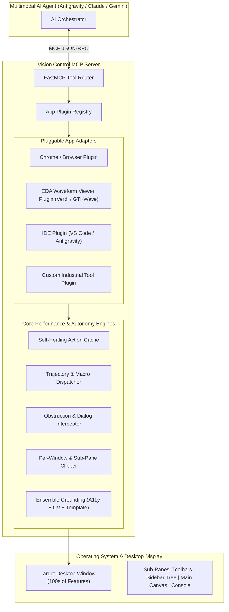

# UI Tool Plugin Architecture & Consolidated Enhancement Strategy

## 1. The Challenge: Operating Complex UI Applications (100s of Features)

Generalist vision models struggle when dropped into dense, expert desktop applications (e.g. EDA waveform viewers like Verdi/GTKWave, CAD suites, IDEs, or Wireshark):

1. **Unlabeled Micro-Icons**: Toolbars contain 40–80 tiny $16 \times 16$ pixel buttons with cryptic graphic glyphs and no text labels. Set-of-Marks generates a dense swarm of overlapping badges.
2. **Deep Menu Hierarchies**: Accessing advanced options requires navigating 3 to 4 nested menu levels (`File > Export > Simulation > VCD...`).
3. **Sub-Pane Heterogeneity**: A single window contains multiple distinct technology stacks (e.g., Qt menus, an OpenGL/custom canvas waveform viewer, a tree view widget, and a headless terminal console).
4. **Token Inflation**: Sending full-window screenshots for every micro-step exhausts token limits and increases latency to unacceptable levels.

---

## 2. The Solution: App-Specific Plugin Architecture (`BaseUIAppPlugin`)

To automate complex UI tools with hundreds of features efficiently and accurately, Vision MCP extends from a generic driver into an **App-Aware Extensible Platform**.



---

## 3. Four Core Capabilities of an App Plugin

### A. The Declarative Feature Map (`FeatureMap`)
Instead of guessing button coordinates visually, each plugin defines a semantic catalog of the application's capabilities:
* **Feature ID**: e.g., `waveform.zoom_in`, `waveform.add_signal`, `simulation.step_forward`.
* **Execution Pathways (Tiered Fallbacks)**:
  1. **Direct Hotkey (Fastest / 0 tokens)**: e.g., `Ctrl++`, `F5`, `Ctrl+Shift+P`.
  2. **Menu Path**: e.g., `["View", "Zoom", "Zoom In"]`.
  3. **Visual Template**: Pre-registered $16 \times 16$ or $24 \times 24$ button icon image for template matching.
  4. **Sub-Pane Constraint**: Target is guaranteed to live inside `toolbar_top`.

### B. Sub-Pane & Region-of-Interest (ROI) Routing
A complex app is divided into functional spatial zones:
```python
panes = {
    "toolbar": BoundingBox(x=0, y=34, width=1600, height=45),
    "signal_tree": BoundingBox(x=0, y=79, width=350, height=800),
    "waveform_canvas": BoundingBox(x=350, y=79, width=1250, height=800),
    "console_log": BoundingBox(x=0, y=879, width=1600, height=300),
}
```
* The AI calls `take_screenshot(pane="toolbar")` or `find_element(query="Zoom In", pane="toolbar")`.
* **Token reduction**: Compresses visual payload from 2,000 tokens down to **~80 tokens**.

### C. Menu Path Traversal Primitive (`navigate_menu`)
Navigating nested desktop menus is automated locally:
```python
navigate_menu(path=["File", "Export", "Waveform Data..."])
```
* The MCP server clicks the top-level menu, waits for popup render, matches the second item, clicks, and traverses to the leaf item without round-tripping to the LLM.

### D. Workflow Macro Recipes (`run_app_macro`)
Encapsulates high-frequency multi-step sequences into single-call routines:
* E.g., `eda_plugin.load_dump_and_format(vcd_path="sim.vcd", signals=["clk", "rst_n", "data_in"])`.

---

## 4. Consolidated Implementation Strategy: Phased Roadmap

```mermaid
flowchart TD
    subgraph Phase 1: Core Performance Foundation
        P1A["1. Per-Window Perception (`capture_window`)"]
        P1B["2. Self-Healing Action Cache (`ActionCache`)"]
        P1C["3. Obstruction Interceptor (`ObstructionHandler`)"]
    end

    subgraph Phase 2: App Plugin Infrastructure
        P2A["4. Plugin Architecture Base (`BaseUIAppPlugin`)"]
        P2B["5. Plugin Auto-Detection & Registry (`PluginRegistry`)"]
        P2C["6. Declarative Feature Map Parser (`FeatureMap`)"]
    end

    subgraph Phase 3: High-Productivity Feature Execution
        P3A["7. Sub-Pane Region Cropping & Focusing (`pane='...'`)"]
        P3B["8. Automated Menu Hierarchy Navigator (`navigate_menu`)"]
        P3C["9. Template Icon Library for Specialized Toolbars"]
    end

    subgraph Phase 4: Autonomous Workflows & Trajectories
        P4A["10. Trajectory Macro Dispatcher (`execute_trajectory`)"]
        P4B["11. App Workflow Macros (`run_app_macro`)"]
        P4C["12. Visual Checkpoint Rollback on Failure"]
    end

    Phase 1 --> Phase 2
    Phase 2 --> Phase 3
    Phase 3 --> Phase 4
```

### Phase 1: Core Performance Foundation (Immediate Value)
1. **Per-Window Perception**: Automatically bounds capture frames to the active window geometry, immediately slashing token consumption by 60–80%.
2. **Self-Healing Action Cache**: Caches verified element locations and templates for sub-80ms, 0-token repeat interactions.
3. **Obstruction Interceptor**: Automatically identifies and dismisses modal dialogs, cookie banners, and permission requests.

### Phase 2: App Plugin Framework
1. **`BaseUIAppPlugin` Interface**: Standardized contracts for window matching, pane layout, feature registries, and custom shortcuts.
2. **`PluginRegistry`**: Dynamically activates the appropriate plugin based on the active window title or `WM_CLASS`.
3. **Reference Plugins**: Implement `BrowserPlugin` (Chrome/Firefox) and a target tool plugin (e.g. `WaveformPlugin` or `IDEPlugin`).

### Phase 3: Sub-Pane & Menu Navigation
1. **Pane-Constrained Grounding**: Grounding queries are executed strictly within relevant bounding sub-regions.
2. **Deterministic Menu Traversal**: Native click-and-wait sequencing through nested menus with visual delta confirmation.
3. **Toolbar Template Catalog**: High-precision template matcher matching $16 \times 16$ icons without text labels.

### Phase 4: Autonomous Trajectory Macros
1. **`execute_trajectory`**: Batch sequence execution allowing the AI orchestrator to issue 10-step plans executed locally at native OS speeds.
2. **State Checkpointing**: Automated checkpointing and rollback enabling safe, independent trial-and-error research.
